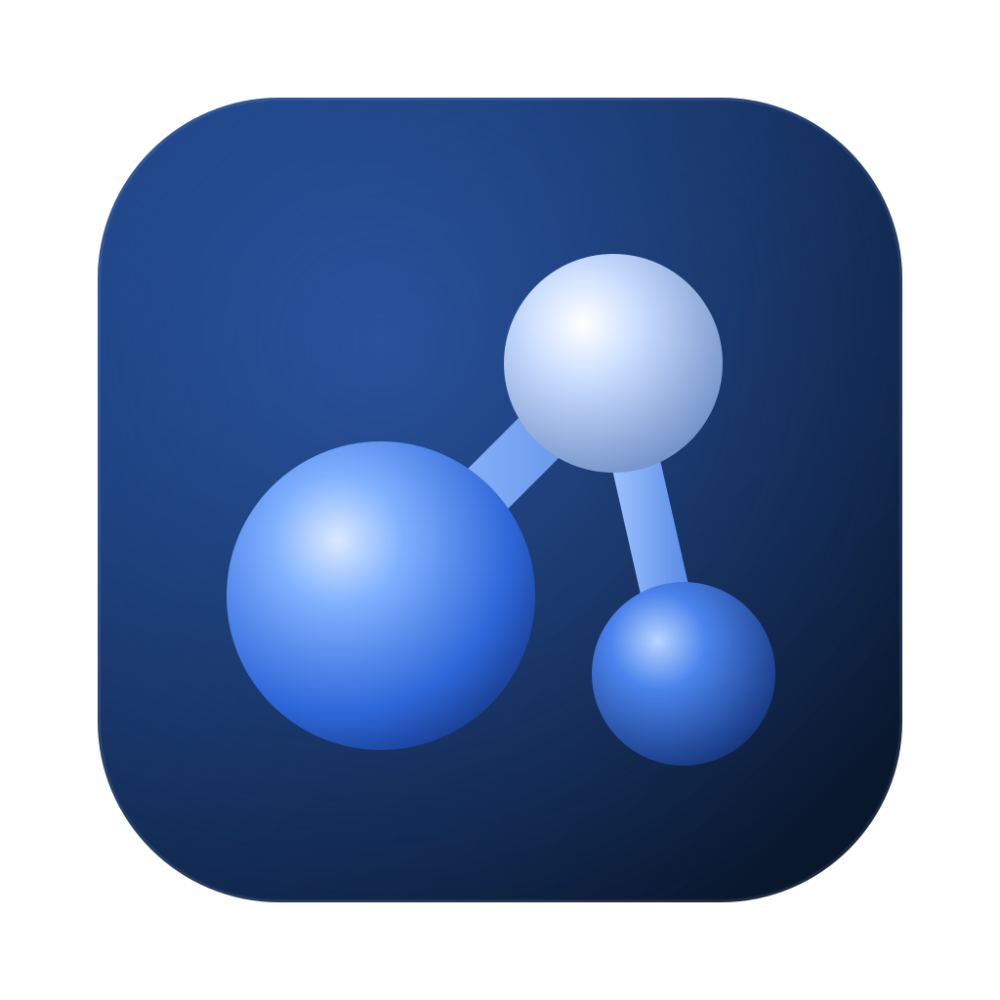
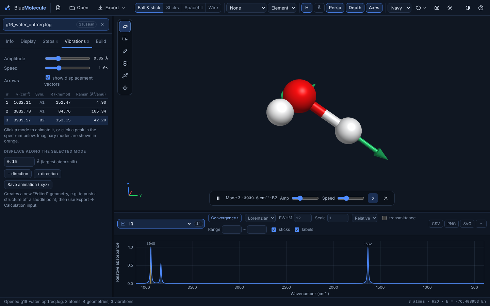
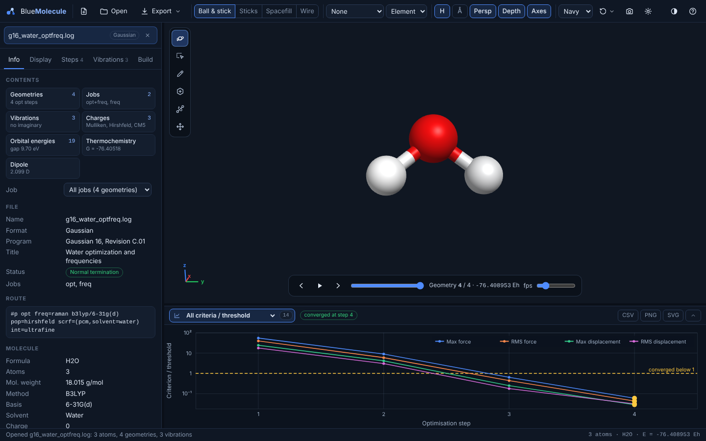
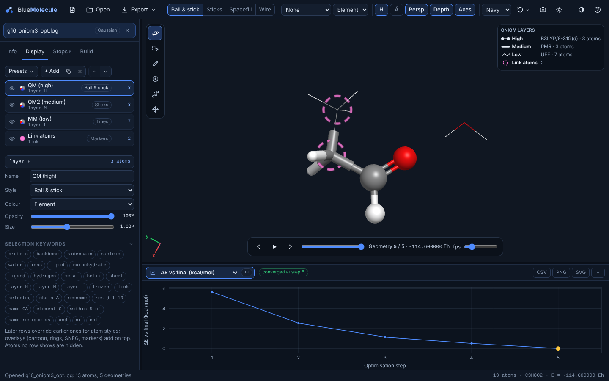
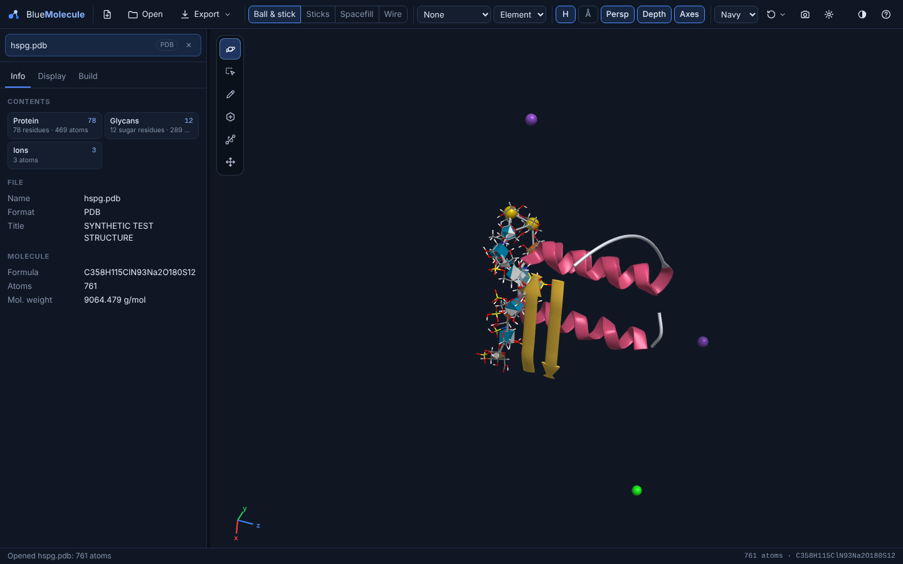
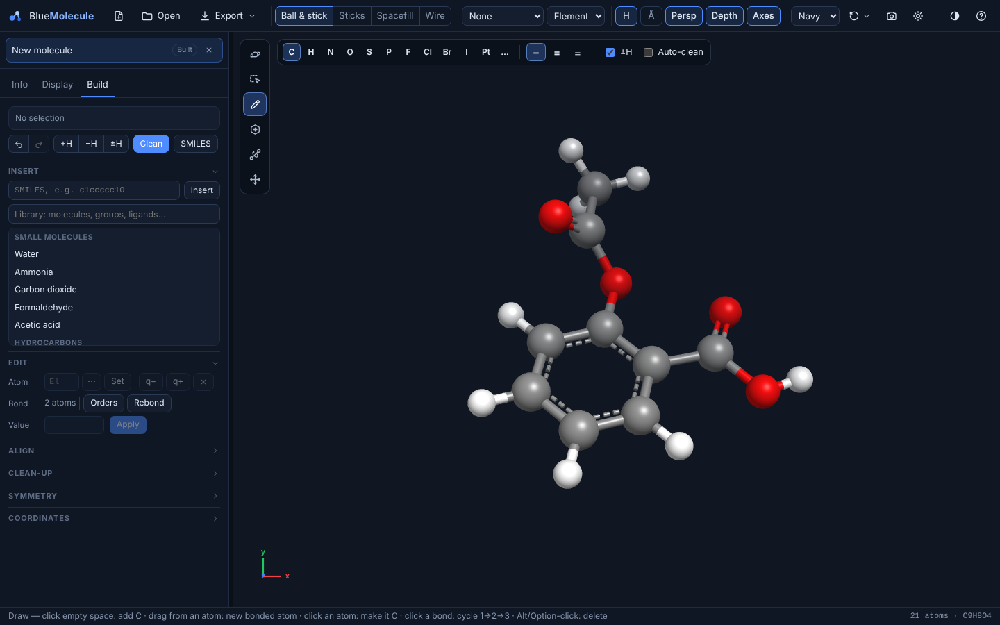

<p align="center">
  
</p>

<h1 align="center">BlueMolecule</h1>

<p align="center">
  A viewer and builder for quantum-chemistry and molecular-modelling files that runs entirely on your own computer.<br>
  <sub>Gaussian · ORCA · GAMESS · NWChem · Q-Chem · Psi4 · xtb · MOPAC · CP2K · Turbomole · VASP · Quantum ESPRESSO · CASTEP · PDB/mmCIF · GROMACS · Amber · CHARMM/NAMD · LAMMPS</sub>
</p>

> [!IMPORTANT]
> **BlueMolecule is a vibe-coded project.** An AI assistant (Claude, made by Anthropic) wrote all of its code, tests
> and documentation. It worked in conversation with the author, who decided what the program should do, tried it and
> reported what went wrong. No person has reviewed the code line by line. It has been tested almost entirely on
> **synthetic** example files rather than real calculations. Use it as a convenient viewer, and **check any number
> you publish against the original output file.**
> [How it was made and what that means →](docs/vibe-coding.md)



## What it does

- **Opens quantum-chemistry outputs.** It shows every geometry of an optimisation, scan or IRC, plus energies and thermochemistry. It also reads orbital energies, charges, dipoles, vibrations, excited states and NMR shieldings. The Info tab lists everything found in the file, and you can pick which job, plot or property to look at.
- **Optimisation graphs.** Energy, ΔE, each convergence criterion against its threshold (log scale), the RMSD to the final geometry and the largest atomic step, all plotted per optimisation step.
- **Spectra.** IR and Raman (Lorentzian or Gaussian broadening, scale factor, ε or relative intensity), UV-Vis and ECD from excited states, and NMR sticks with a reference shielding. Each plot exports as CSV, PNG or SVG.
- **Vibrations.** Animated modes with displacement arrows, imaginary frequencies highlighted, displacement along a mode, and multi-frame XYZ animations.
- **QM/MM and ONIOM.**
  - Supports Gaussian ONIOM (2 or 3 layers), ORCA QM/MM and QM/XTB, CP2K QM/MM and xtb ONIOM.
  - Layers, link atoms and frozen atoms are read from the file.
  - Each optimisation step is one point at the total energy, so the energy graph no longer jumps back and forth between sub-calculations.
  - A layer view shows each layer in its own style, with a legend naming the method.
- **Macromolecules.**
  - Proteins: cartoon coloured by secondary structure.
  - Nucleic acids: backbone tube with base slabs.
  - Lipids: tails as lines with phosphorus and nitrogen spheres.
  - Carbohydrates: filled rings and the standard glycan symbols (SNFG). Sugars are recognised by name or, for six-membered rings, by their stereochemistry.
  - Each kind has a ready-made view, and a [VMD-like selection language](docs/selection-language.md) gives finer control (`within 5 of ligand`, `layer H`, `resname POPC`…).
- **Building and editing.**
  - Avogadro-style tools: draw, select, templates, bond-centric and manipulate.
  - SMILES input and a library of molecules, groups, ligands and coordination geometries.
  - Hydrogen and bond-order handling, a clean-up force field, point-group detection and symmetrization, and a coordinate editor.
- **Exports.** Writes 24 structure, crystal and MD formats and calculation inputs for 10 programs. Other formats go through Open Babel when it is installed. Images can be saved at higher resolution.
- **Large files.** Outputs of hundreds of megabytes or more are read in chunks. Long DCD, TRR or XTC trajectories are thinned to fit in memory.
- **Its own window.** On Linux it opens a Qt WebEngine window, or a browser app window if Qt is missing, with its own name and icon. On macOS it is a small native app (experimental). The single HTML file also works in any modern browser.
- **Private by design.** Nothing is uploaded. The only network traffic is between the window and its own launcher on `127.0.0.1`.

<table>
  <tr>
    <td></td>
    <td></td>
  </tr>
  <tr>
    <td align="center"><sub>Convergence criteria divided by their thresholds, per optimisation step</sub></td>
    <td align="center"><sub>Three-layer ONIOM: layer styles, link atoms and the methods legend</sub></td>
  </tr>
  <tr>
    <td></td>
    <td></td>
  </tr>
  <tr>
    <td align="center"><sub>Protein cartoon with glycan symbols (synthetic test structure)</sub></td>
    <td align="center"><sub>Building from SMILES and editing with the draw tool</sub></td>
  </tr>
</table>

## Install

Download the latest release from the **[Releases page](https://github.com/fred4h/BlueMolecule/releases)**.

**Linux** (the main platform; needs `python3`):

```bash
tar xzf BlueMolecule-1.4.1-linux.tar.gz
cd BlueMolecule-1.4.1-linux
./install.sh                 # installs for your user in ~/.local; offers to install Qt WebEngine for Python
bluemolecule calc.log        # or start it from the applications menu, or use "Open With" on a file
```

**macOS** (experimental, not yet tested on a real Mac): unzip `BlueMolecule-1.4.1-macOS.zip`, then double-click
**Install BlueMolecule.command**. It needs Apple's free Command Line Tools.

**Any computer:** open `BlueMolecule.html` in Chrome, Edge, Firefox or Safari. It works offline, but saving goes
through the browser's downloads and Open Babel is not available.

More detail, options and uninstalling: [docs/installation.md](docs/installation.md).
Building from source needs only Python 3: `python3 tools/build.py`.

## Documentation

| | |
|---|---|
| [Installation](docs/installation.md) | Linux, macOS and browser; window types; Open Babel; uninstalling |
| [User guide](docs/user-guide.md) | The window, mouse and keyboard, toolbar, tabs, plots, exporting |
| [Analysing outputs](docs/analysing-outputs.md) | Contents overview, optimisations, scans and IRC, vibrations, spectra, excited states, NMR, orbitals, charges |
| [QM/MM and ONIOM](docs/qmmm-oniom.md) | What is read from each program, energies, layer views |
| [Representations](docs/representations.md) | Display rows, styles, colour schemes, presets, proteins, nucleic acids, lipids, glycans |
| [Selection language](docs/selection-language.md) | Complete reference with examples |
| [Building and editing](docs/building-and-editing.md) | Build tools, library, hydrogens, clean-up, symmetry, calculation inputs |
| [File formats](docs/file-formats.md) | Every format that can be opened or saved |
| [Large files and trajectories](docs/large-files-and-trajectories.md) | Very large outputs, topology plus trajectory, memory |
| [Troubleshooting](docs/troubleshooting.md) | Window opens in a browser, files that will not open, Wayland, diagnostics |
| [Status and limitations](docs/limitations.md) | What has and has not been verified |
| [How it was made](docs/vibe-coding.md) | The vibe-coding process and what it implies |
| [Developer guide](docs/developer-guide.md) | Architecture, data model, adding a reader, building, tests |

## Status

BlueMolecule 1.4.1 is the first public release. The automated test suite has about 8,000 checks:
- format readers and writers against example files;
- chemistry routines;
- the selection language;
- the launcher;
- browser tests that drive the real interface.

All of these files were written to imitate each program's output, because no real outputs were available while it
was written. Real outputs can differ in details the examples do not cover.
[docs/limitations.md](docs/limitations.md) lists what has and has not been verified. A file that opens wrongly is
the most useful bug report you can send (see [CONTRIBUTING.md](CONTRIBUTING.md)).

## Contributing

Bug reports with a small example file are very welcome. So are fixes, including AI-assisted ones, as long as they come with
tests. See [CONTRIBUTING.md](CONTRIBUTING.md). Please do not attach unpublished or confidential research data to public
issues. Security issues: see [SECURITY.md](SECURITY.md).

## License and credits

BlueMolecule is released under the [MIT License](LICENSE). Copyright © 2026 Frederico Henrique Do. C. R. Ferreira.

Reference data comes from the scientific literature:
- covalent radii: Cordero et al., *Dalton Trans.* 2008;
- van der Waals radii: Bondi, *J. Phys. Chem.* 1964;
- atomic weights: IUPAC;
- physical constants: CODATA 2018;
- element colours: the common CPK/Jmol scheme;
- glycan symbols: the Symbol Nomenclature for Glycans (SNFG), Varki et al., *Glycobiology* 2015.

BlueMolecule is an independent project. It is not affiliated with or endorsed by the makers of Chemcraft, GaussView,
Avogadro, VMD, Gaussian, ORCA or any other program named here. Those names are trademarks of their owners and are used
only to describe file compatibility and features. BlueMolecule contains no code, data, icons or text taken from any
of them.
