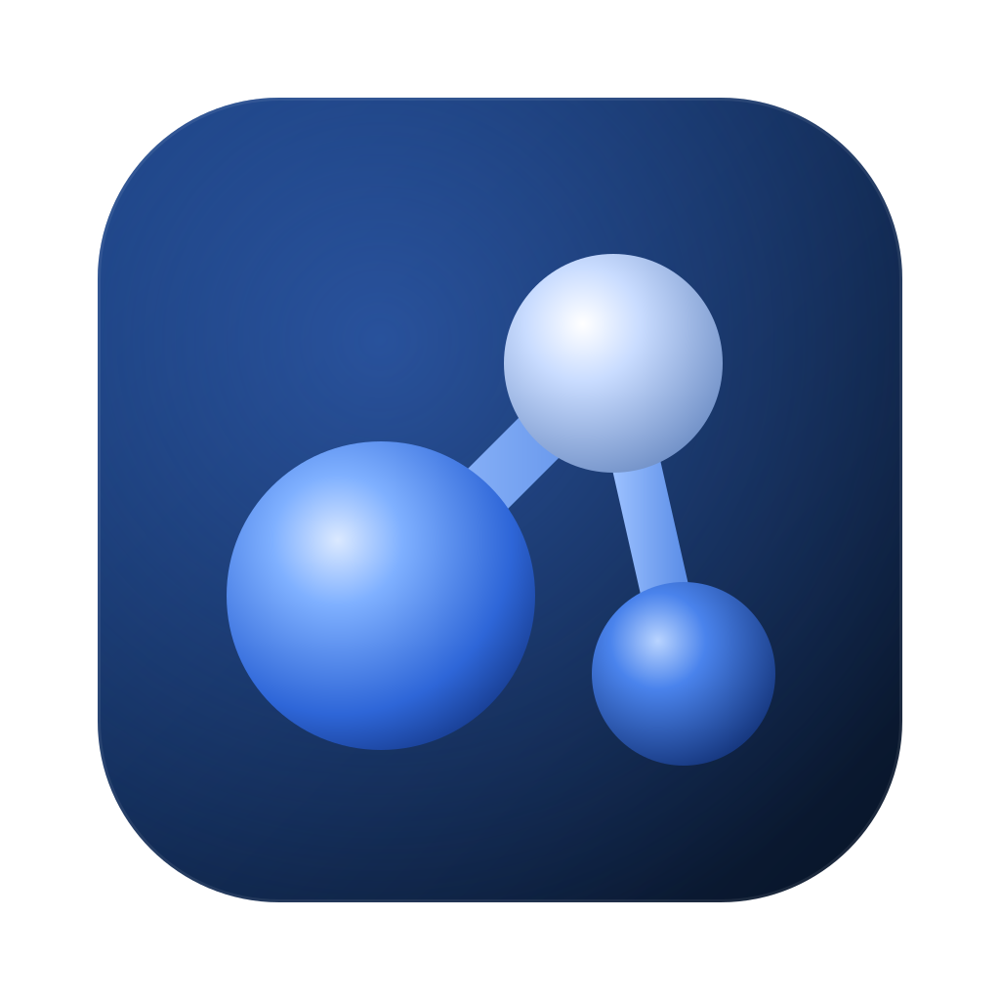
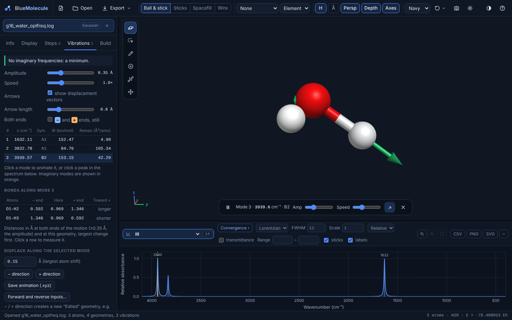
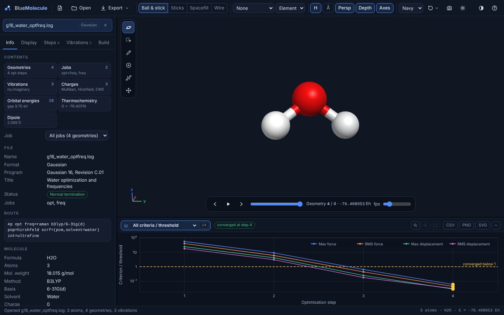
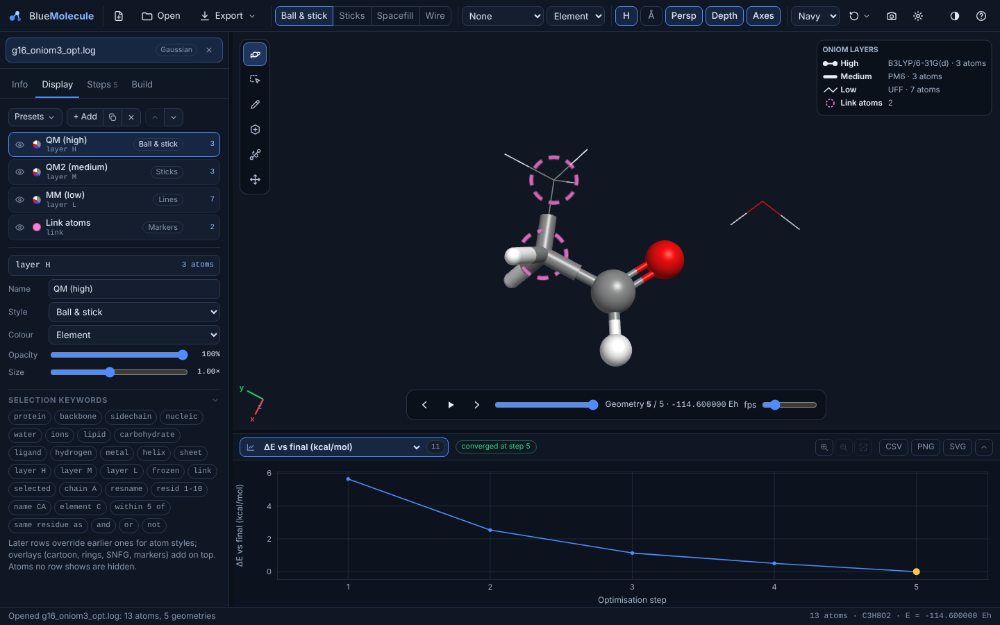
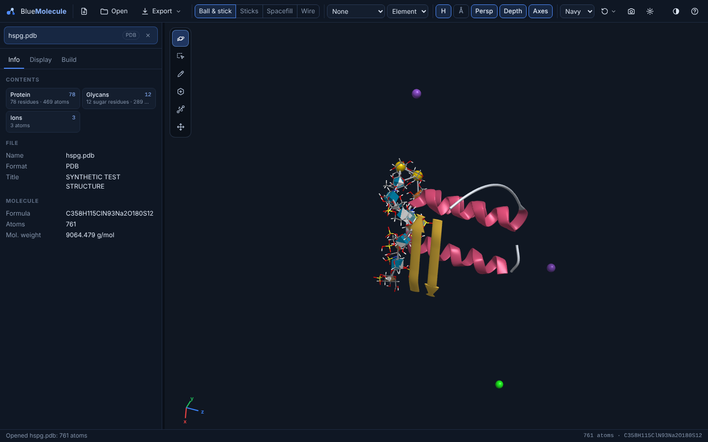
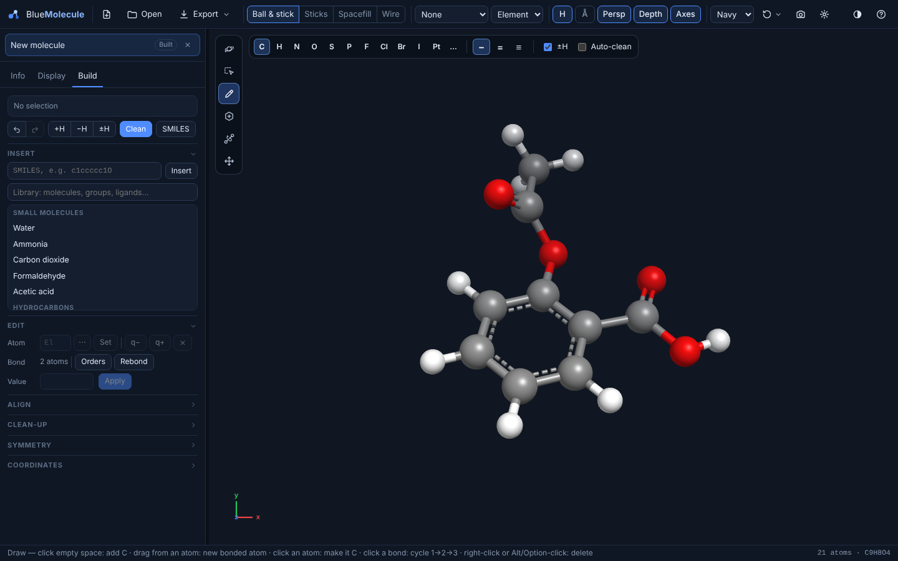

  

<h1 align="center">BlueMolecule</h1>

  A viewer and builder for quantum-chemistry and molecular-modelling files that runs entirely on your own computer. 
  Gaussian · ORCA · GAMESS · NWChem · Q-Chem · Psi4 · Molpro · Dalton · xtb · MOPAC · CP2K · Turbomole · VASP · Quantum ESPRESSO · CASTEP · PDB/mmCIF · GROMACS · Amber · CHARMM/NAMD · LAMMPS

> [!IMPORTANT]
> **BlueMolecule is a vibe-coded project.** An AI assistant (Claude, made by Anthropic) wrote all of its code, tests
> and documentation. It worked in conversation with the author, who decided what the program should do, tried it and
> reported what went wrong. No person has reviewed the code line by line. It was tested mostly on **synthetic**
> example files and, since 2.0.1, on public collections of real outputs, not on the variety of real calculations.
> Use it as a convenient viewer, and **check any number you publish against the original output file.**
> [How it was made and what that means →](docs/vibe-coding.md)

## What it does

- **Opens quantum-chemistry outputs.** It shows every geometry of an optimisation, scan or IRC, plus energies and thermochemistry. It also reads orbital energies, charges, dipoles, vibrations, excited states and NMR shieldings. The Info tab lists everything found in the file, and you can pick which job, plot or property to look at.
- **Optimisation graphs.** Energy, ΔE, each convergence criterion against its threshold (log scale), the RMSD to the final geometry and the largest atomic step, all plotted per optimisation step.
- **Spectra.** IR and Raman (Lorentzian or Gaussian broadening, scale factor, ε or relative intensity), UV-Vis and ECD from excited states, and NMR sticks with a reference shielding.
- **Orbitals and surfaces.** Orbitals, electron densities and spin densities computed straight from fchk and Molden files (Gaussian, Q-Chem, Psi4, ORCA, CFOUR, Turbomole, Molpro), without cubegen or orca_plot, in the background on several cores. Van der Waals, solvent-accessible and solvent-excluded surfaces, and the electrostatic potential coloured onto a surface from atomic charges or a potential cube. Isosurfaces of cube and XSF volumes.
- **Zoomable plots.** Drag a box to zoom into any plot, or use the magnifier buttons; a click still selects. Each plot exports as CSV, PNG or SVG, as zoomed.
- **Vibrations.** Animated modes with displacement arrows, imaginary frequencies highlighted, displacement along a mode, and multi-frame XYZ animations. For transition states: the number of imaginary frequencies, both ends of the motion, the bonds that form and break, forward and reverse optimisation inputs in one click, and the negative Hessian eigenvalues of the TS search.
- **QM/MM and ONIOM.**
  - Supports Gaussian ONIOM (2 or 3 layers), ORCA QM/MM and QM/XTB, CP2K QM/MM and xtb ONIOM.
  - Layers, link atoms and frozen atoms are read from the file.
  - Each optimisation step is one point at the total energy, so the energy graph no longer jumps back and forth between sub-calculations.
  - The component energies (each layer and level, or QM, MM and QM–MM) are plotted next to the total.
  - A layer view shows each layer in its own style, with a legend naming the method.
- **Macromolecules.**
  - Proteins: cartoon coloured by secondary structure.
  - Nucleic acids: backbone tube with base slabs.
  - Lipids: tails as lines with phosphorus and nitrogen spheres.
  - Carbohydrates: filled rings and the standard glycan symbols (SNFG). Sugars are recognised by name or, for six-membered rings, by their stereochemistry.
  - Each kind has a ready-made view, and a [VMD-like selection language](docs/selection-language.md) gives finer control (`within 5 of ligand`, `layer H`, `resname POPC`…).
- **Scenes and effects.** Ready-made scenes for publication figures, a studio look, a dark background and cartoons, or each effect on its own: glossy, matte or flat materials, ambient occlusion, outlines, depth of field, shadows on a floor and a background gradient.
- **Building and editing.**
  - Avogadro-style tools: draw, select, templates, bond-centric and manipulate.
  - SMILES input and a library of molecules, groups, ligands and coordination geometries.
  - Hydrogen and bond-order handling, a clean-up force field, point-group detection and symmetrization, and a coordinate editor.
  - A conformer search (rotatable bonds turned, relaxed with the clean-up force field, kept when distinct), and crystal tools: supercells, surface slabs from Miller indices, cell edits and boxes around molecules.
- **Downloads from PubChem and the PDB.** A molecule from PubChem by name or CID (its 3D conformer), or an entry or its biological assembly from the Protein Data Bank by ID. Off until you allow it.
- **Exports.** Writes 24 structure, crystal and MD formats and calculation inputs for 10 programs. Other formats go through Open Babel when it is installed. Images are saved as PNG, JPEG, WebP, TIFF or PDF at a print size and resolution, with an sRGB or Display P3 colour profile, up to poster size.
- **Large files.** Outputs of hundreds of megabytes are read in chunks, and Gaussian and ORCA outputs of several gigabytes (QM/MM jobs on whole proteins) are condensed while they are read. For files of 1 GB and more, a dialog lets you choose what to load: every Nth step or frame, a range, or the last N, and which vibrations to animate.
- **MD trajectories.** Amber (prmtop with text or NetCDF coordinates and trajectories), CHARMM/NAMD (PSF, DCD), GROMACS (GRO, TRR, XTC) and LAMMPS, read in slices when they are long.
- **Its own window.** A desktop program for Linux, Windows and macOS, with an installer, **Open with** entries for chemistry files and a built-in updater. The single HTML file also works in any modern browser.
- **Private by design.** Nothing is uploaded. BlueMolecule uses the network only when you ask: to check for updates, and to download from PubChem or the PDB once you have allowed it. A download sends only the name or ID you typed.

<table>
  <tr>
    <td></td>
    <td></td>
  </tr>
  <tr>
    <td align="center">Convergence criteria divided by their thresholds, per optimisation step</td>
    <td align="center">Three-layer ONIOM: layer styles, link atoms and the methods legend</td>
  </tr>
  <tr>
    <td></td>
    <td></td>
  </tr>
  <tr>
    <td align="center">Protein cartoon with glycan symbols (synthetic test structure)</td>
    <td align="center">Building from SMILES and editing with the draw tool</td>
  </tr>
</table>

## Install

Download the latest release from the **[Releases page](https://github.com/fred4h/BlueMolecule/releases)**.
BlueMolecule is a desktop program of its own on each system, with an installer, **Open with** entries for
chemistry files and a built-in updater:

| System | Download | Install |
|---|---|---|
| Ubuntu, Kubuntu, Debian… | `BlueMolecule_VERSION_amd64.deb` | `sudo apt install ./BlueMolecule_VERSION_amd64.deb` |
| Any 64-bit Linux | `BlueMolecule_VERSION_amd64.AppImage` | `chmod +x` it and run it |
| Windows 10 and 11 | `BlueMolecule_VERSION_x64-setup.exe` | Run it (no administrator rights needed) |
| macOS 10.15 or later | `BlueMolecule_VERSION_universal.dmg` | Drag BlueMolecule to Applications |

The installers are not code-signed, so Windows and macOS warn once before the first start;
[the installation guide](docs/installation.md) says how to go on, and how to remove a 1.x installation first.

**Any computer:** open `BlueMolecule.html` in Chrome, Edge, Firefox or Safari. It works offline, but Open Babel is
not available.

## Documentation

| | |
|---|---|
| [Installation](docs/installation.md) | Linux, Windows, macOS and browser; updates; Open Babel; uninstalling |
| [User guide](docs/user-guide.md) | The window, mouse and keyboard, toolbar, downloads from PubChem and the PDB, tabs, plots, exporting |
| [Analysing outputs](docs/analysing-outputs.md) | Contents overview, optimisations, scans and IRC, vibrations, spectra, excited states, NMR, orbitals and surfaces, charges |
| [QM/MM and ONIOM](docs/qmmm-oniom.md) | What is read from each program, energies, layer views |
| [Representations](docs/representations.md) | Display rows, styles, colour schemes, presets, proteins, nucleic acids, lipids, glycans |
| [Selection language](docs/selection-language.md) | Complete reference with examples |
| [Building and editing](docs/building-and-editing.md) | Build tools, library, hydrogens, clean-up, conformers, crystal tools, symmetry, calculation inputs |
| [File formats](docs/file-formats.md) | Every format that can be opened or saved |
| [Large files and trajectories](docs/large-files-and-trajectories.md) | Very large outputs, choosing what to load, topology plus trajectory, Amber NetCDF, memory |
| [Troubleshooting](docs/troubleshooting.md) | Window opens in a browser, files that will not open, Wayland, diagnostics |
| [Status and limitations](docs/limitations.md) | What has and has not been verified |
| [How it was made](docs/vibe-coding.md) | The vibe-coding process and what it implies |
| [Developer guide](docs/developer-guide.md) | Architecture, data model, adding a reader, building, tests |

## Status

BlueMolecule 2.6.2 is the current release (1.4.1 was the first public one). The automated test suite has about
37,400 checks in 45 suites, 24,500 of them from cutting example outputs as a running job would leave them:
- format readers and writers against example files;
- chemistry routines;
- the selection language;
- the launcher;
- browser tests that drive the real interface;
- the desktop program, built and started on Linux, Windows and macOS by the cloud builds.

These example files were written to imitate each program's output, because no real outputs were available while
the program was written. For 2.0.1, every reader was also run on the public test files of the cclib and MDAnalysis
projects (real outputs of nine quantum-chemistry programs, and real topologies and trajectories) and the differences
were fixed. Outputs of other versions and job types can still differ in details neither set covers.
[docs/limitations.md](docs/limitations.md) lists what has and has not been verified. A file that opens wrongly is
the most useful bug report you can send (see [CONTRIBUTING.md](CONTRIBUTING.md)).

## Contributing

Bug reports with a small example file are very welcome. So are fixes, including AI-assisted ones, as long as they come with
tests. See [CONTRIBUTING.md](CONTRIBUTING.md). Please do not attach unpublished or confidential research data to public
issues. Security issues: see [SECURITY.md](SECURITY.md).

## License and credits

BlueMolecule is released under the [MIT License](LICENSE). Copyright © 2026 Frederico Henrique Do. C. R. Ferreira.

Reference data comes from the scientific literature:
- covalent radii: Cordero et al., *Dalton Trans.* 2008;
- van der Waals radii: Bondi, *J. Phys. Chem.* 1964;
- atomic weights: IUPAC;
- physical constants: CODATA 2018;
- element colours: the common CPK/Jmol scheme;
- glycan symbols: the Symbol Nomenclature for Glycans (SNFG), Varki et al., *Glycobiology* 2015.

BlueMolecule is an independent project. It is not affiliated with or endorsed by the makers of Chemcraft, GaussView,
Avogadro, VMD, Gaussian, ORCA or any other program named here, nor by PubChem or the RCSB Protein Data Bank. Those names
are trademarks of their owners and are used only to describe file compatibility and features. BlueMolecule contains no code, data, icons or text taken from any
of them.
