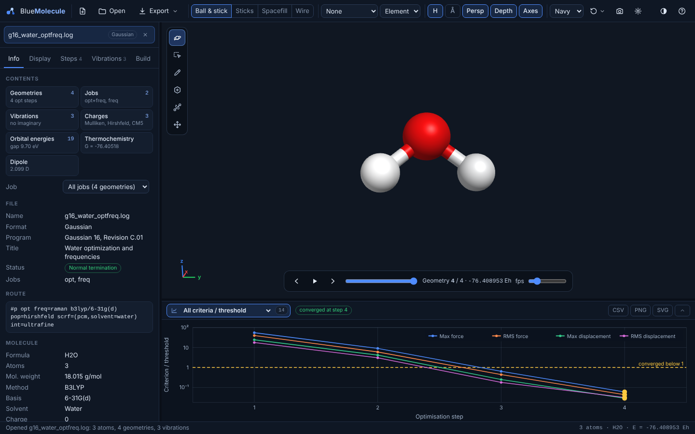
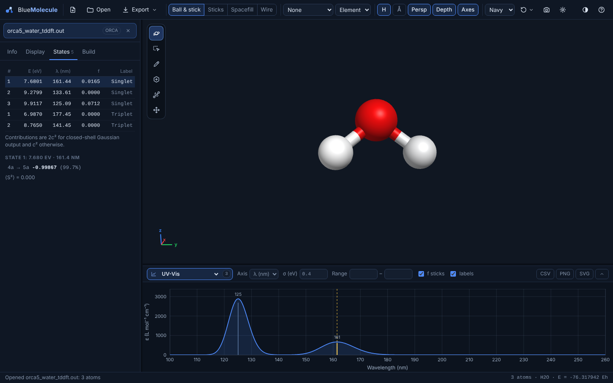

# Analysing outputs

This page covers what BlueMolecule shows for the output of a quantum-chemistry job: Gaussian, ORCA, GAMESS,
NWChem, Q-Chem, Psi4, xtb, MOPAC, CP2K, Turbomole, VASP or Quantum ESPRESSO. [File formats](file-formats.md) says
which program provides which kind of data. QM/MM and ONIOM jobs have [their own page](qmmm-oniom.md).

> [!NOTE]
> BlueMolecule displays numbers computed by your quantum-chemistry program. It does not compute energies or
> properties itself. Spectra are simulated from the computed lines with the broadening you choose. Check any value
> you publish in the original output ([why](vibe-coding.md#what-this-means-for-you)).

## The Info tab

**Contents** at the top lists everything the reader found, with counts. Each item opens its tab or plot:
- geometries, with the number of optimisation, scan or IRC steps;
- jobs;
- vibrations, and whether any are imaginary;
- charges, with the schemes found;
- orbital energies, with the HOMO–LUMO gap;
- thermochemistry, with the Gibbs energy;
- the dipole moment;
- excited states, and whether ECD is available;
- NMR shieldings;
- volumes;
- the unit cell;
- QM/MM or ONIOM layers;
- macromolecule parts: protein, nucleic acid, lipids, glycans, water, ions, ligands.

**Several jobs in one file** are listed as separate jobs: Gaussian `--Link1--`, ORCA `$new_job` and compound jobs,
for example "opt+freq, freq". The **Job** selector restricts the Steps tab, the playbar and the plots to one job.
**All jobs** shows everything.

Below the overview:

| Section | Contents |
|---|---|
| File | Name, format, program and version, title, status (normal or error termination, or still running), job types |
| Route / Keywords | The route section (Gaussian) or keyword lines (ORCA and others) |
| Molecule | Formula, number of atoms, molecular weight, method, basis set, charge, multiplicity, solvent |
| Energy | The final energy and the energy of the geometry shown |
| Thermochemistry | ZPE, E + ZPE, enthalpy H and Gibbs energy G, at the temperature of the job |
| Orbitals | HOMO, LUMO and gap, for α and β separately in open-shell jobs |
| Dipole moment | Total and components (Debye). **Display settings → Dipole moment arrow** draws it |
| Atomic charges | The scheme in use, when the file has several |
| Unit cell | a, b, c, α, β, γ and the volume, for periodic systems |
| Reader notes | Anything unusual the reader noticed: missing geometries, unfinished jobs, skipped frames, conversions |

## Optimisations

Every geometry of an optimisation is a frame. Play them with the playbar, or click a row of the **Steps** tab.

**Steps tab**
- Each geometry with its energy (Eh) and ΔE in kcal/mol, kJ/mol or eV, relative to the lowest, first or last
  geometry.
- A mark on converged points of scans and IRCs, and a **converged points only** filter.
- **Convergence at geometry N**: each criterion the program printed, with its threshold and ✓ or ✗:
  - maximum and RMS force;
  - maximum and RMS displacement;
  - energy change;
  - gradient norm.

**Optimisation plots** (the plot picker's *Optimisation* group):

| Plot | What it shows |
|---|---|
| Energy | The total energy of each optimisation step |
| ΔE vs final | The energy relative to the last step, in the chosen unit |
| One plot per criterion | Max force, RMS force, max displacement, RMS displacement, energy change or gradient norm, with the threshold as a dashed line (log scale) |
| RMSD to final | The RMSD of each geometry from the final one, after optimal superposition (Kabsch) |
| Largest atomic step | The largest displacement of any atom from the previous geometry |
| All criteria / threshold | Every criterion divided by its threshold on one log-scale plot. A criterion is met below 1 |

A badge such as **converged at step 5** marks the step where the program reported convergence. Click a point to
go to that geometry.

Different programs print different criteria:
- Gaussian prints forces and displacements with their thresholds.
- ORCA prints the energy change, gradients and steps.
- xtb, MOPAC and Turbomole print a gradient norm.

Some outputs, such as xtb, MOPAC and CP2K, report optimisation cycles without printing every geometry. Their
energies and criteria are still plotted per cycle.

## Scans and IRC

Relaxed scans (Gaussian ModRedundant, ORCA `%geom Scan`) and IRC paths are recognised. The plot picker then offers
**Scan: energy vs coordinate** or **IRC: energy vs reaction coordinate**. The energy profile has one point per scan
step: the converged geometry of that step. The intermediate optimisation geometries therefore do not clutter it,
and they stay available in the Steps tab. ORCA's IRC path summary is plotted even when the output does not print
every IRC geometry.

## Vibrations

The **Vibrations** tab lists each mode with:
- its frequency (cm⁻¹), with imaginary frequencies shown in orange as e.g. `523.41i`;
- its symmetry label, when printed;
- its IR intensity (km/mol) and Raman activity (Å⁴/amu), when computed.

- **Click a mode**, or a peak in the spectrum, to animate it. **Amplitude** and **Speed** adjust the animation, and
  **Arrows** shows the displacement vectors.
- **Displace along the selected mode** (− or + direction, by a chosen largest atom shift in Å) creates a new
  edited geometry. Use it, for example, to push a structure off a saddle point, then
  **Export → Calculation input** to start a new optimisation.
- **Save animation (.xyz)**: the mode as a multi-frame XYZ.

## Spectra

The spectrum controls are in the plot panel. Every spectrum can be saved as CSV (the simulated curve and the
sticks), PNG or SVG.

**IR**
- Line shape: Lorentzian or Gaussian, with a **FWHM** in cm⁻¹.
- A frequency **scale factor**.
- A wavenumber **range**.
- Sticks and peak labels on or off.
- Intensity as relative absorbance or molar absorption coefficient **ε**, and an optional transmittance view.

**Raman**
- The same line-shape controls.
- The y axis is either the Raman **activity** as printed, or the **intensity** for a chosen excitation wavelength
  λ₀ (nm) and temperature (K).

**UV-Vis**
- Built from the excited states' oscillator strengths, with a Gaussian band of width σ (eV).
- The x axis is wavelength (nm) or energy (eV); the y axis is ε (L mol⁻¹ cm⁻¹).

**ECD**
- Built from the rotatory strengths of the excited states, giving Δε.
- Same broadening and axis choices as UV-Vis. Offered only when the output contains rotatory strengths.

**NMR**
- Sticks of the isotropic shieldings for the chosen **nucleus**.
- Enter a **reference shielding** σref (ppm) to plot chemical shifts δ = σref − σ instead. Leave it at 0 to plot
  shieldings.
- **merge** combines shieldings within 0.05 ppm into one stick, and **labels** names the atoms.
- Click a stick to select its atoms.

## Excited states

The **States** tab lists each excited state with its energy (eV), wavelength (nm), oscillator strength f and label,
for example `Singlet-B2`. Selecting a state shows:
- its orbital transitions, such as `5 → 7` or `HOMO → LUMO`, with coefficients;
- the weight of each transition: 2c² for closed-shell Gaussian output, c² otherwise;
- ⟨S²⟩, when it is printed.

Selecting a state also marks it in the UV-Vis or ECD spectrum, and clicking a band in the spectrum selects the
state.

## Orbitals and volumes

- **MO energy levels**: the plot picker's *Orbitals* group draws a level diagram of the orbital energies, with
  occupied and virtual levels and α and β separately for open-shell jobs. Click a level to select it. The HOMO,
  LUMO and gap are also in the Info tab.
- **Isosurfaces** come from volumetric files:
  - Gaussian cube, including cubes with several orbitals;
  - XSF data grids.

  The **Surfaces** tab has one entry per volume, with:
  - visibility;
  - **isovalue**, as a slider or a typed number;
  - **opacity**;
  - colours of the positive and negative lobes, and whether to show both (**± lobes**).

  The grid size and the value range are printed below.
- **Making a cube:** to view an orbital, density or electrostatic potential, write a cube file with your program.
  Use `cubegen` (Gaussian) or `orca_plot` (ORCA), then open it. Formatted checkpoint (fchk) files give the
  structure, vibrations, charges, dipole and orbital energies; Molden files give the structure and vibrations.
  BlueMolecule does **not yet compute orbitals on a grid** from either ([limitations](limitations.md)).

## Atomic charges

Charges are read in every scheme the output prints:
- Mulliken and Löwdin;
- Hirshfeld and CM5;
- NPA;
- ESP-fitted (CHELPG, Merz–Kollman);
- APT.

Use them in three ways:
- **Labels → Charges** prints them on the atoms, and **Colour → Charge** colours the atoms by charge.
- The **Atomic charges** plot shows the charge of every atom. Choose the **Scheme** in its controls, and click a
  bar to select the atom. It is available up to 5,000 atoms.
- **CSV** exports the charges with the atom numbers and elements.

## Periodic systems

CIF, mmCIF, VASP, Quantum ESPRESSO, CASTEP, CP2K, XSF, LAMMPS and GRO files can carry a unit cell. It is drawn
in the 3D view (**Display settings → Unit cell**) and listed in the Info tab. VASP OUTCAR and Quantum ESPRESSO
outputs give the geometries and energies of relaxations; VASP XDATCAR and LAMMPS dumps give trajectories.
