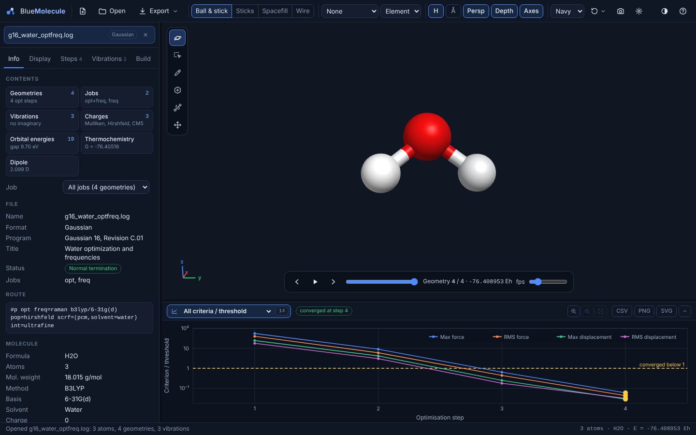
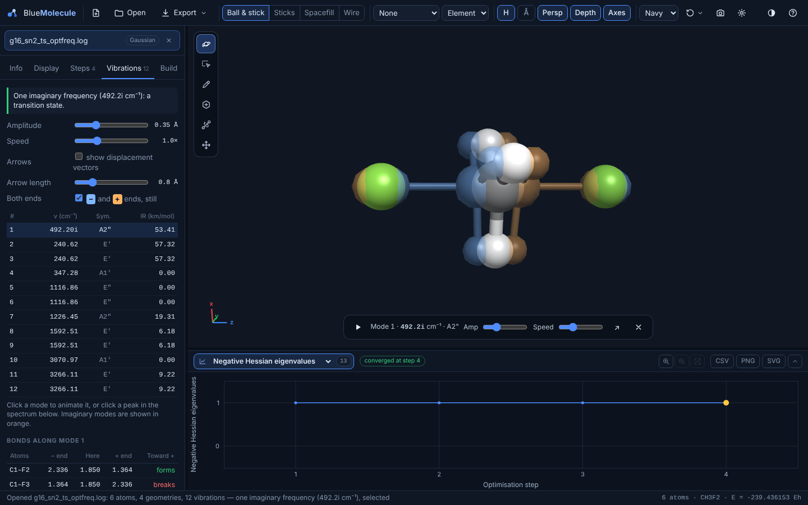
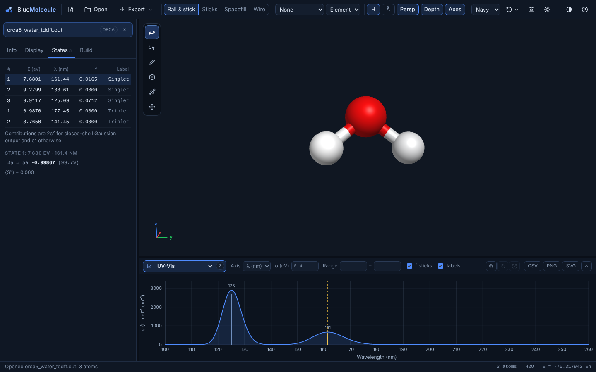

# Analysing outputs

This page covers what BlueMolecule shows for the output of a quantum-chemistry job: Gaussian, ORCA, GAMESS,
NWChem, Q-Chem, Psi4, Molpro, Dalton, xtb, MOPAC, CP2K, Turbomole, VASP or Quantum ESPRESSO. [File formats](file-formats.md) says
which program provides which kind of data. QM/MM and ONIOM jobs have [their own page](qmmm-oniom.md).

> [!NOTE]
> BlueMolecule displays numbers computed by your quantum-chemistry program. It does not compute energies or
> properties itself. Spectra are simulated from the computed lines with the broadening you choose. Check any value
> you publish in the original output ([why](vibe-coding.md#what-this-means-for-you)).

## The Info tab

**Contents** at the top lists everything the reader found, with counts. Each item opens its tab or plot:
- geometries, with the number of optimisation, scan or IRC steps;
- jobs;
- vibrations, and whether any are imaginary;
- charges, with the schemes found;
- orbital energies, with the HOMO–LUMO gap;
- thermochemistry, with the Gibbs energy;
- the dipole moment;
- excited states, and whether ECD is available;
- NMR shieldings;
- volumes;
- the unit cell;
- QM/MM or ONIOM layers;
- macromolecule parts: protein, nucleic acid, lipids, glycans, water, ions, ligands.

**Several jobs in one file** are listed as separate jobs: Gaussian `--Link1--`, ORCA `$new_job` and compound jobs,
for example "opt+freq, freq". The **Job** selector restricts the Steps tab, the playbar and the plots to one job.
**All jobs** shows everything.

Below the overview:

| Section | Contents |
|---|---|
| File | Name, format, program and version, title, status (normal or error termination, or still running), job types |
| Route / Keywords | The route section (Gaussian) or keyword lines (ORCA and others) |
| Molecule | Formula, number of atoms, molecular weight, method, basis set, charge, multiplicity, solvent |
| Energy | The energy of the geometry shown, with its level (SCF, MP2, CCSD(T)...) when the job computed several, the other levels (and a TD-DFT job's excited state) below it, and the final energy |
| Thermochemistry | ZPE, E + ZPE, enthalpy H and Gibbs energy G, at the temperature of the job |
| Orbitals | HOMO, LUMO and gap, for α and β separately in open-shell jobs |
| Dipole moment | Total and components (Debye). **Display settings → Dipole moment arrow** draws it |
| Atomic charges | The scheme in use, when the file has several |
| Unit cell | a, b, c, α, β, γ and the volume, for periodic systems |
| Reader notes | Anything unusual the reader noticed: missing geometries, unfinished jobs, skipped frames, conversions |

**The energy of a geometry** is the highest level the job computed for it: CCSD(T) or QCISD(T), then CCSD, QCISD
and CCD, MP5, MP4 (SDTQ, else SDQ, else DQ), MP3, MP2, and the SCF energy. In a TD-DFT or CIS single point, it is the
ground state's (MP2 for ADC(2)): the excited states are in the **States** tab. In such ORCA jobs the "FINAL SINGLE
POINT ENERGY" is the energy of the followed excited state; it is used only when the job follows that state (an
excited-state optimisation, scan or IRC), as for Gaussian. (In ORCA's ROCIS jobs it is the ROCIS ground state, and it
is shown.)

## Optimisations

Every geometry of an optimisation is a frame. Play them with the playbar, click a row of the **Steps** tab, or
press **↑ / ↓** (or **← / →**) to go to the previous or next geometry; **Page Up / Page Down** jump 10 rows and
**Home / End** go to the first and last. The same keys move through the **Vibrations** and **States** lists.

**Jobs that are still running** can be opened at any time. A geometry whose energy is not printed yet is marked
*in progress* and has no ΔE and no point in the energy plots; it is never counted as 0. If the file ends in the middle of a line,
that line is left out, and the Info tab says *Not finished: still running?*. Open the file again later to see the
new steps.

**Steps tab**
- Each geometry with its energy (Eh) and ΔE in kcal/mol, kJ/mol or eV, relative to the lowest, first or last
  geometry.
- A mark on converged points of scans and IRCs, and a **converged points only** filter.
- **Convergence at geometry N**: each criterion the program printed, with its threshold and ✓ or ✗:
  - maximum and RMS force;
  - maximum and RMS displacement;
  - energy change;
  - gradient norm;
  - the number of negative eigenvalues of the optimiser's Hessian, when the program prints the eigenvalues
    (Gaussian and Q-Chem). A transition-state search should keep exactly one.

**Optimisation plots** (the plot picker's *Optimisation* group):

| Plot | What it shows |
|---|---|
| Energy | The total energy of each optimisation step |
| ΔE vs final | The energy relative to the last step, in the chosen unit |
| Energy components | QM/MM and ONIOM runs only: the total and each component (high and low level on the model and real systems, or QM, MM and QM–MM interaction), each relative to its own final value, with a legend. The CSV gives the energies in hartree |
| One plot per criterion | Max force, RMS force, max displacement, RMS displacement, energy change or gradient norm, with the threshold as a dashed line (log scale) |
| RMSD to final | The RMSD of each geometry from the final one, after optimal superposition (Kabsch) |
| Largest atomic step | The largest displacement of any atom from the previous geometry |
| All criteria / threshold | Every criterion divided by its threshold on one log-scale plot. A criterion is met below 1 |
| Negative Hessian eigenvalues | Transition-state searches (and minimisations that meet a negative eigenvalue): the number of negative eigenvalues of the optimiser's Hessian at each step, from Gaussian's `Eigenvalues ---` rows and Q-Chem's `Hessian Eigenvalues:` block. A good TS search stays at 1 |

A badge such as **converged at step 5** marks the step where the program reported convergence. Click a point to
go to that geometry.

Different programs print different criteria:
- Gaussian prints forces and displacements with their thresholds.
- ORCA prints the energy change, gradients and steps.
- xtb, MOPAC and Turbomole print a gradient norm.
- Molpro prints the largest gradient and step with their thresholds, and the step length; Dalton the gradient norm
  and the step length.

Some outputs, such as xtb, MOPAC, CP2K and Molpro, report optimisation cycles without printing every geometry. Their
energies and criteria are still plotted per cycle. A Molpro optimisation converges when the largest gradient and
either the energy change or the largest step are below their thresholds, so not every criterion has to be met.

Formatted checkpoint (fchk) files keep the history of an optimisation: Gaussian's every geometry and energy, also
for each point of a relaxed scan, and Q-Chem's every geometry (without energies).

## Scans and IRC

Relaxed scans (Gaussian ModRedundant, ORCA `%geom Scan`) and IRC paths are recognised. The plot picker then offers
**Scan: energy vs coordinate** or **IRC: energy vs reaction coordinate**. The energy profile has one point per scan
step: the converged geometry of that step. The intermediate optimisation geometries therefore do not clutter it,
and they stay available in the Steps tab. ORCA's IRC path summary is plotted even when the output does not print
every IRC geometry.

## Vibrations

The **Vibrations** tab lists each mode with:
- its frequency (cm⁻¹), with imaginary frequencies shown in orange as e.g. `523.41i`;
- its symmetry label, when printed;
- its IR intensity (km/mol; for MOPAC, the squared transition dipole in D²) and Raman activity (Å⁴/amu), when
  computed.

A line at the top of the tab says what the frequencies make of the structure, and how many imaginary frequencies
there are:
- none: a minimum (for a transition-state search, *not* a transition state);
- exactly one: a transition state;
- more than one: a higher-order saddle point.

Imaginary frequencies below 50i cm⁻¹ are counted apart: in a minimum they are often numerical noise, from loose
convergence or a coarse integration grid. When a file has an imaginary mode (one above 50i cm⁻¹, or any in a
transition-state search), opening it selects the largest one, and the message on opening gives the count.
**Show it** in that line selects the imaginary mode again.

- **Click a mode**, or a peak in the spectrum, to animate it.
- **Amplitude** is the largest atom shift of the animation, in Å. **Speed** sets how fast it moves.
- **Arrows** shows the displacement vectors. **Arrow length** sets the length of the longest one, in Å, whatever
  the amplitude.
- **Both ends** stops the animation at the centre and shows the two ends of the motion (± the amplitude) as
  translucent structures, blue for the − end and orange for the + end. The bonds drawn at each end follow its own
  distances, so a bond that forms appears at one end only. Press play to animate with the ends shown.

**Bonds along mode N** lists the atom pairs whose distance changes most along the selected mode, with the distance at
the − end, at this geometry and at the + end (± the amplitude). Pairs that only span an angle are left out. Along
the imaginary mode of a transition state, a partial bond that gets shorter towards the + end **forms** and one
that gets longer **breaks**. A bond counts as partial when it is longer than 1.15 × the sum of the covalent radii,
or is drawn at one end only. For other modes and for ordinary bonds the table says **shorter** or **longer**. Click
a row to measure that distance: the measurement follows the animation.

**Displace along the selected mode** uses a largest atom shift in Å (0.15 by default):
- **− direction** and **+ direction** each create a new edited geometry, for example to push a structure off a saddle
  point. Then use **Export → Calculation input** to start a new optimisation.
- **Forward and reverse inputs…** writes two optimisation inputs at once: *name*_minus and *name*_plus, from the
  geometry displaced by − and + that shift. Optimising both shows which minima the transition state connects (an
  IRC does this more rigorously).
  - The dialog is the usual calculation-input dialog, with the Task set to **Optimization**.
  - A Gaussian route or ORCA keyword line taken from the file becomes an optimisation:
    - Gaussian: `opt=(ts,calcfc,noeigentest)` becomes `opt`, other `opt` options and keywords are kept, `opt` is
      added when missing, and `geom=` and `guess=` are dropped;
    - ORCA: `OptTS` becomes `Opt`.
  - Check the route before running the inputs.
- **Save animation (.xyz)**: the mode as a multi-frame XYZ.

## Spectra

The spectrum controls are in the plot panel. Every spectrum can be saved as CSV (the simulated curve and the
sticks), PNG or SVG.

**IR**
- Line shape: Lorentzian or Gaussian, with a **FWHM** in cm⁻¹.
- A frequency **scale factor**.
- A wavenumber **range**.
- Sticks and peak labels on or off.
- Intensity as relative absorbance or molar absorption coefficient **ε** (not for MOPAC, whose intensities are
  relative), and an optional transmittance view.

**Raman**
- The same line-shape controls.
- The y axis is either the Raman **activity** as printed, or the **intensity** for a chosen excitation wavelength
  λ₀ (nm) and temperature (K).

**UV-Vis**
- Built from the excited states' oscillator strengths, with a Gaussian band of width σ (eV).
- The x axis is wavelength (nm) or energy (eV); the y axis is ε (L mol⁻¹ cm⁻¹).

**ECD**
- Built from the rotatory strengths of the excited states, giving Δε.
- Same broadening and axis choices as UV-Vis. Offered only when the output contains rotatory strengths.

**NMR**
- Sticks of the isotropic shieldings for the chosen **nucleus**.
- Enter a **reference shielding** σref (ppm) to plot chemical shifts δ = σref − σ instead. Leave it at 0 to plot
  shieldings.
- **merge** combines shieldings within 0.05 ppm into one stick, and **labels** names the atoms.
- Click a stick to select its atoms.

## Excited states

The **States** tab lists each excited state with its energy (eV), wavelength (nm), oscillator strength f and label,
for example `Singlet-B2`. Selecting a state shows:
- its orbital transitions, such as `5 → 7` or `HOMO → LUMO`, with coefficients;
- the weight of each transition: 2c² for closed-shell Gaussian output, c² otherwise;
- ⟨S²⟩, when it is printed.

Selecting a state also marks it in the UV-Vis or ECD spectrum, and clicking a band in the spectrum selects the
state.

Excited states are also read from Gaussian and Q-Chem fchk files (energies and oscillator strengths, and for
Gaussian whether each state is a singlet or a triplet), Dalton response outputs, and Turbomole's escf (with ECD
rotatory strengths and orbital contributions) and ricc2 (CC2, ADC(2)) outputs.

## Orbitals and volumes

- **MO energy levels**: the plot picker's *Orbitals* group draws a level diagram of the orbital energies, with
  occupied and virtual levels and α and β separately for open-shell jobs. Click a level to select it. When the file
  holds the orbitals themselves (fchk and Molden files, below), **Show orbital** draws the selected one. The HOMO,
  LUMO and gap are also in the Info tab.
- **Orbitals and densities from fchk and Molden files**, in the **Surfaces** tab. BlueMolecule computes them from the
  basis set and MO coefficients in the file, as `cubegen` and `orca_plot` do, so no cube file is needed.
  - **Show**: an orbital, the electron density, or the spin density (open-shell jobs). For an orbital, pick it in the
    menu (with its energy, occupation and HOMO/LUMO label; α or β for open-shell jobs), or use **HOMO** and
    **LUMO**.
  - **Grid**: coarse, medium or fine (0.45, 0.3 or 0.2 Bohr between points), over the molecule plus 4 Å.
  - **Compute** runs in the background, on several processor cores when there are some, with a progress bar, the
    time left and **Cancel**. Each result joins the list of surfaces below and is shown alone. Its check box shows
    it again later without computing it again.
  - Shells of any angular momentum, pure or Cartesian, are read. Programs write Molden files in different
    conventions. BlueMolecule checks that the orbitals are orthonormal, which also checks the reading, and
    recognises the conventions of ORCA, Psi4 (before 1.0, and 1.0 to 1.3.2), CFOUR and Turbomole. The tab says which
    convention it found, or warns when the orbitals are orthonormal in none of them.
  - **Save as → Molden** writes the basis set and orbitals in the standard Molden convention, so an fchk file can be
    opened by programs that read Molden files.
- **Isosurfaces** also come from volumetric files:
  - Gaussian cube, including cubes with several orbitals;
  - XSF data grids.

  The **Surfaces** tab has one entry per volume, with:
  - visibility;
  - **isovalue**, as a slider or a typed number;
  - **opacity**;
  - colours of the positive and negative lobes, and whether to show both (**± lobes**).

  The grid size and the value range are printed below. A computed volume has a **×** to remove it. The visible
  volume can be saved as a cube file (**Save as → Gaussian cube**).
- **Molecular surfaces**, in the Surfaces tab of any structure:
  - **van der Waals**: the atoms' spheres;
  - **solvent accessible**: the surface traced by the centre of a probe sphere rolling over the atoms;
  - **solvent excluded** (Connolly): the surface its front touches, which fills the grooves between atoms.

  The probe radius is 1.4 Å (water) unless you change it. The surface is computed for the geometry shown.
- **Electrostatic potential on a surface.** The **Colour** menu of a density surface or a molecular surface colours it
  by the potential: red where it is negative (electron rich), white near zero, blue where it is positive. The range is
  in atomic units, with kcal/mol printed too. The potential comes from:
  - the file's atomic charges (Mulliken, ESP, NPA…), as point charges at the atoms, which is an approximation;
  - a potential cube (from `cubegen potential`, for example) opened for the same atoms, in the same document or
    another one.

## Atomic charges

Charges are read in every scheme the output prints:
- Mulliken and Löwdin;
- Hirshfeld and CM5;
- NPA;
- ESP-fitted (CHELPG, Merz–Kollman);
- APT.

Use them in three ways:
- **Labels → Charges** prints them on the atoms, and **Colour → Charge** colours the atoms by charge.
- The **Atomic charges** plot shows the charge of every atom. Choose the **Scheme** in its controls, and click a
  bar to select the atom. It is available up to 5,000 atoms.
- **CSV** exports the charges with the atom numbers and elements.

## Periodic systems

CIF, mmCIF, VASP, Quantum ESPRESSO, CASTEP, CP2K, XSF, LAMMPS and GRO files can carry a unit cell. It is drawn
in the 3D view (**Display settings → Unit cell**) and listed in the Info tab. VASP OUTCAR and Quantum ESPRESSO
outputs give the geometries and energies of relaxations; VASP XDATCAR and LAMMPS dumps give trajectories.
