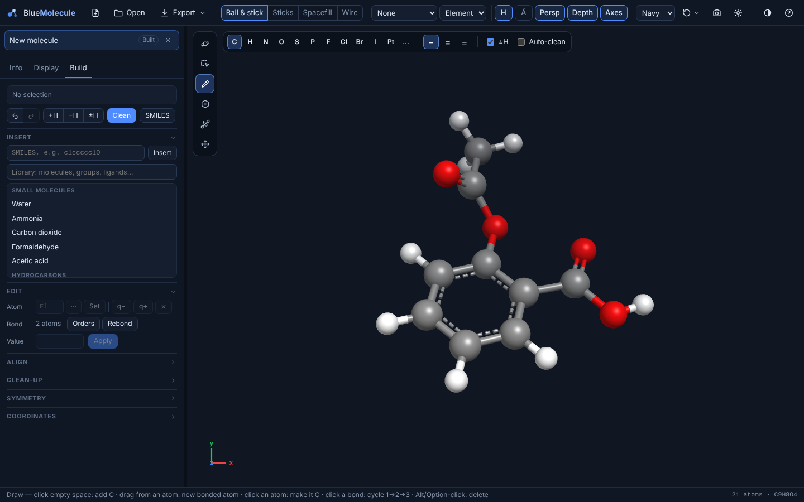

# Building and editing

BlueMolecule can build molecules from scratch and edit any geometry it has opened. Use it to prepare a starting
structure, fix one from a calculation, or push a structure off a saddle point, then write the input for the next
job.

Start with **New** (an empty molecule), **Build** on the start screen (from SMILES), or the **Build** tab of any open
file. Editing a geometry from a file creates an **edited copy**: the file's own geometries stay unchanged, and the
Build tab says which copy you are editing. Every change can be undone with **Ctrl/⌘ + Z** and redone with
**Ctrl/⌘ + Shift + Z** or **Ctrl + Y**.

## The build tools

The tool palette is at the left edge of the 3D view. The active tool's options appear in a bar at the top of the
view, and the status bar shows its hints.

| Tool | Key | What it does |
|---|---|---|
| **Navigate** | N | Rotate, pan and zoom; click atoms to select and measure (the default) |
| **Select** | S | Drag a box to select (Shift adds, Ctrl/⌘ removes), click to toggle an atom, double-click to select a whole fragment. Options: select by element, select all, invert |
| **Draw** | D | Click empty space to add an atom; drag from an atom to add a bonded atom; click an atom to change it to the current element; click a bond to cycle single → double → triple; Alt/Option-click to delete. Options: element (common elements plus the periodic table), bond order, automatic hydrogens (±H), automatic clean-up |
| **Template** | T | Insert from the library. **Groups**: attach a substituent to an atom. **Molecules**: insert a molecule. **Metal**: build a metal centre with a chosen coordination geometry. **Ligands**: replace ligands at the selected sites, including bidentate ligands |
| **Bond-centric** | K | Drag a bond to rotate its smaller side around it; Shift-drag to stretch it |
| **Manipulate** | M | Drag an atom to move its fragment, or the selection; Shift-drag to rotate it |

**Ctrl/⌘ + A** selects all atoms, and **Delete** or **Backspace** deletes the selected ones.

## The Build tab

The top of the Build tab shows the selection and these buttons:
- undo and redo;
- **+H** adds hydrogens to satisfy valences, **−H** removes hydrogens, **±H** fixes wrong hydrogen counts. Each acts
  on the selected atoms, or on all atoms when nothing is selected;
- **Clean** relaxes the structure with the clean-up force field;
- **SMILES** copies the SMILES of the structure.

### Insert

- **SMILES**: type a SMILES string and press **Insert** or Enter to build 3D coordinates, e.g. `c1ccccc1O` or
  `CC(=O)Oc1ccccc1C(=O)O`. Aromatic SMILES are kekulized, and charges and brackets are understood.
- **Library**: search the built-in library and click an entry. A **molecule** is inserted beside the structure; a
  **group** or **ligand** goes onto the selected atom(s). With nothing selected, the Template tool is armed so that
  you can click where it should go.

| Library section | Entries |
|---|---|
| Small molecules | Water, ammonia, carbon dioxide, formaldehyde, acetic acid |
| Hydrocarbons | Methane, ethane, ethylene, acetylene, cyclohexane (chair), cyclopentane |
| Aromatics and heterocycles | Benzene, toluene, naphthalene, pyridine, pyrrole, furan, thiophene, imidazole |
| Solvents | Methanol, ethanol, acetone, acetonitrile, DMSO, dichloromethane, chloroform, THF |
| Metal complexes | Cisplatin, transplatin |
| Groups | Methyl, ethyl, isopropyl, tert-butyl; phenyl, benzyl; vinyl, ethynyl; hydroxy, methoxy; amino, dimethylamino, nitro, cyano; CF₃, F, Cl, Br, I; formyl, carboxyl, methoxycarbonyl, carbamoyl, acetyl; thiol, sulfo |
| Monodentate ligands | Hydride, halides, hydroxide, aqua, ammine, carbonyl, cyanide, acetonitrile, phosphines (PH₃, PMe₃, PPh₃) and more |
| Bidentate ligands | en, bipy, oxalate, acac, phen |
| Coordination geometries | Linear, trigonal planar, tetrahedral, square planar, seesaw, T-shaped, trigonal bipyramidal, square pyramidal, octahedral, pentagonal bipyramidal |

### Edit

- **Atom**: give the selected atoms a new element (type it, or pick from the periodic table) and press **Set**.
  Change formal charges with **q− / q+**, or delete the atoms.
- **Bond**: with two atoms selected, set their bond to single, double or triple, or delete it.
  - **Orders** perceives single, double, triple and aromatic bond orders for the whole structure.
  - **Rebond** recomputes the connectivity from the distances.
- **Value**: with 2, 3 or 4 atoms selected, type a distance, angle or dihedral and press **Apply**. The smaller
  fragment moves; inside a ring only the last atom does.

### Align

- **Atom → 0**: translate so that the selected atom is at the origin.
- **→XY**: put the plane of three selected atoms into the XY plane, with the first atom at the origin and the second
  on +X.
- **Centre**: move the centroid to the origin.

### Clean-up

**Clean** in the header relaxes the structure. In this section:
- **Auto** relaxes the structure after every drawing, template or manipulation step;
- **Freeze sel.** and **Unfreeze** keep atoms fixed during clean-up.

The clean-up uses an **original, generic force field**, written for BlueMolecule. It is *not* UFF, MMFF or any other
published force field, and *not* a quantum-chemical method. It exists to turn sketched or distorted structures
into reasonable starting geometries, with sensible bond lengths, angles and ring shapes. Always optimise the result
with a real method before drawing conclusions.

### Symmetry

- Choose a **tolerance**: tight (0.02 Å), normal (0.1 Å) or loose (0.3 Å).
- **Detect** reports the point group and its order.
- **Symmetrize** makes the structure exactly symmetric in the detected group, as a new edited geometry, and reports
  the largest atom shift.

This is useful before a calculation that should use symmetry, or to clean up a structure that is almost symmetric.

### Coordinates

A text editor with one `Symbol x y z` line per atom, in Å. Edit it, or paste the contents of an XYZ file, a Gaussian
input or an ORCA input, then press **Apply**. Bonds and bond orders are recomputed. **Copy** copies the
coordinates, and **Revert** discards your changes.

### Size limits

Some operations are switched off for large structures, to keep the interface responsive:

| Operation | Up to |
|---|---|
| Automatic bond-order perception | 2,000 atoms |
| Automatic clean-up after each edit | 1,500 atoms |
| Clean-up | 3,000 atoms |
| Symmetry detection and symmetrization | 1,000 atoms |
| Coordinate editor | 20,000 atoms |

## Calculation inputs

**Export → Calculation input…** writes an input file for the current geometry. It works for a structure you built
or for a geometry from an output, for example the last step of an optimisation, a displaced geometry or a
symmetrized one.

| Setting | Notes |
|---|---|
| **Program** | Gaussian, ORCA, Psi4, Q-Chem, NWChem, GAMESS, MOPAC, xtb, Molpro, Turbomole |
| **Task** | Single point, optimisation, frequencies, or optimisation + frequencies |
| **Method** and **Basis set** | Free text, remembered for each program. Semi-empirical (PM6, PM7, AM1…) and xtb methods (GFN2-xTB, GFN-FF) need no basis |
| **Charge** and **Multiplicity** | Taken from the file when known |
| **Solvent** | Implicit solvation in each program's own syntax and solvent names (e.g. SMD in Gaussian, CPCM in ORCA) |
| **Cores** and **Memory** | Written in each program's syntax (`%nprocshared`/`%mem`, `%pal`/`%maxcore`, …) |
| **Title**, **Extra keywords** | Added to the route or keyword lines |

The dialog shows an **editable preview** of the whole input file and saves what the preview contains. For a
Gaussian or ORCA output, it can reuse the route or keyword line of the opened file. Your choices are remembered for
next time.

> [!NOTE]
> The inputs are a convenient starting point. Read them before running a job, especially the keyword spellings for
> solvents and methods, which differ between programs and versions.
