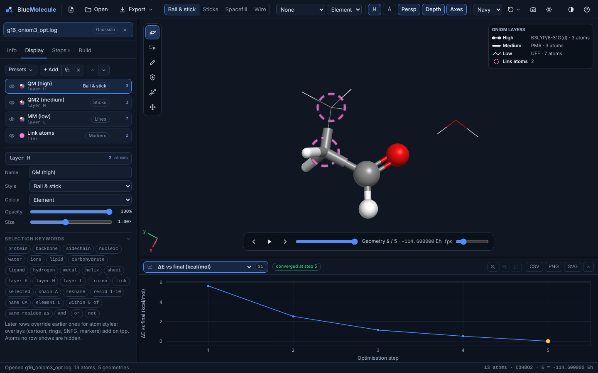

# QM/MM and ONIOM calculations

BlueMolecule reads multi-layer calculations and shows each layer in its own style.



## Supported programs

| Program | Calculations | What is read |
|---|---|---|
| **Gaussian** | ONIOM with 2 or 3 layers: any QM:QM, QM:MM or QM:QM:MM combination, including Amber, UFF and Dreiding for the low layer; optimisations with microiterations; frequencies. Outputs (`.log`) and inputs (`.gjf`, `.com`) | The layer of every atom (H, M or L), link atoms with their element, type and the atom they are bonded to, MM atom types and charges, freeze codes, and residue names written by GaussView (`PDBName`, `ResName`, `ResNum`). For each optimisation step: the total (extrapolated) ONIOM energy and the layer energies (high-model, low-model, low-real, and for 3 layers also med-mid, med-model and low-mid) |
| **ORCA** | QM/MM (ORCA 6), QM/XTB and QM/QM2 | The QM (and QM2) atoms, active and frozen atoms, and link atoms. For each step: the total energy and its components (QM, MM, QM–MM, or high-model, low-model and low-real for QM/QM2) |
| **CP2K** | QM/MM | The QM atoms and link atoms; the energy of each optimisation step |
| **xtb** | ONIOM (`--oniom`, e.g. GFN2-xTB:GFN-FF) | The inner-region atoms and the two methods |

## Energies: one point per optimisation step

A QM/MM or ONIOM output prints many energies in each optimisation cycle:
- the SCF energy of every sub-calculation (the model system at the high level, the model system at the low level,
  the real system at the low level);
- MM energies of the microiterations;
- the total.

A reader that treats every printed energy as a new point produces an energy graph that jumps back and forth.

BlueMolecule keeps **one geometry per optimisation step**: the full system, with **one total energy**. For
Gaussian that is the `ONIOM: extrapolated energy`; for ORCA, the total QM/MM (or QM/QM2) energy: ORCA 6 prints
`FINAL SINGLE POINT ENERGY (MM)` (the full system with the force field), then the QM region's final energy, then
`FINAL SINGLE POINT ENERGY (QM/MM)`, the one used. The layer and component energies are read and stored with each
step too. The **Energy components** plot (in the plot picker's
*Optimisation* group) draws the total and each component, each relative to its own final value, so you can see
which part of the system drives the optimisation. The Info tab lists the components of the geometry shown.

ORCA usually prints only the QM region (its QM atoms, then its link atoms), not the full system: this is the case
with `*pdbfile` inputs, where ORCA writes the full system to its trajectory and PDB files. BlueMolecule then shows the
QM region, marks its link atoms, and says so under **Reader notes**.

## Outputs that do not list the layers

Some outputs do not say which atom is in which layer:
- a Gaussian job that takes its molecule from the checkpoint file (`Geom=Check` or `Geom=AllCheck`, often the
  second and later jobs of a series started with `%OldChk`): Gaussian prints the coordinates and freeze codes, but
  no layers;
- an ORCA QM/MM output whose input echo has no `QMAtoms` list, and no QM-region geometry to match;
- an xtb ONIOM run whose inner region is given in a file, or a CP2K run whose QM atoms cannot be matched.

For Gaussian, BlueMolecule first **reads the layers from the population analysis** of the high-level calculation on
the model system. There Gaussian prints a Mulliken charge for every atom of the real system:
- the QM atoms have their charges;
- the atoms that link atoms replace are printed with the link atom's element (usually H);
- the other atoms have 0 or, with electronic embedding (`EmbedCharge`), their fixed MM charges.

With mechanical embedding, the atoms with a charge are the model system. With electronic embedding, the MM atoms
keep the same charges from one geometry to the next while the QM charges change, so a job with two such tables (an
optimisation and frequency job prints one at the start of the optimisation and one in the frequency step) gives the
model system too. A 3-layer job also needs the medium-level calculation on the mid system. The result is used only
when it has exactly as many atoms as Gaussian counted for that system (`NActive`), and **Reader notes** says where the
layers came from. This also finds parts of the QM region that are bonded to no link atom (waters, ions, a ligand).

Otherwise BlueMolecule tries to **rebuild the layers from the link atoms**. Gaussian prints each link atom
(`ONIOM: Cut between`) and how many atoms the QM side has (`NQM`, with Gaussian's own MM: Amber, UFF, Dreiding);
ORCA prints its link atoms and the number of QM atoms. The QM region is taken as the atoms covalently bonded to the
QM side of the link atoms. It is used only when it has exactly the number of atoms the program counted, and
**Reader notes** says that it was rebuilt. It cannot work when part of the QM region is bonded to no link atom: a
water, an ion or a ligand on its own.

Otherwise the layers are not shown (rather than guessed). The Info tab's Contents then has an **ONIOM layers: not
listed** item, which leads to the **ONIOM layers** (or **QM/MM layers**) section. **Take them from another
document**: click **Open file with the layers…** and choose a file of the same system that lists them, with the same
atoms in the same order, for example the input or the first output of the Gaussian series. Its layers are copied at
once. A file that is already open can be chosen under **From** instead, then **Use**. The layers, link atoms and
residue names are copied; the document keeps its own method labels, freeze codes and energies. The same works to
replace read or rebuilt layers with the original assignment.

The geometries and energies are read in every case.

## Viewing the layers

When a QM/MM or ONIOM file is opened, the **QM/MM layers** preset is applied automatically:

| Layer | Default style |
|---|---|
| High layer, or QM region | Ball & stick |
| Medium layer, or QM2 region | Sticks |
| Low layer, or MM region | Lines |
| Frozen atoms | Dimmed |
| Link atoms | Marked with a dashed ring |

A **legend** in the corner of the 3D view names each layer's method, for example `B3LYP/6-31G(d)`, `PM6` or `UFF`,
with its atom count.

The **Info** tab lists the layers under Contents (*High layer*, *Medium layer*, *Low layer*, or *QM region* and
*MM region*), with their methods and atom counts. Clicking one selects its atoms. The status bar shows the layer
of the atom under the mouse.

Every part of the preset can be changed in the **Display** tab ([representations](representations.md)): style,
colour (including **colour by QM/MM layer**), opacity and size, row by row. The
[selection language](selection-language.md) has layer keywords:

| Keyword | Atoms |
|---|---|
| `layer H`, `qm`, `high` | The high layer or QM region |
| `layer M`, `qm2`, `medium` | The medium layer or QM2 region |
| `layer L`, `mm`, `low` | The low layer or MM region |
| `link` | Link atoms |
| `frozen` / `active` | Frozen and active (optimised) atoms |

Some useful rows:

```text
layer H                                 the QM region, e.g. ball & stick
same residue as within 5 of layer H     whole residues around it, e.g. sticks
layer L and not water                   the MM environment without the solvent, e.g. lines
water and within 8 of layer H           only the nearby water
frozen                                  frozen atoms, e.g. ghost (translucent)
```

For a protein environment, combine the layer rows with the macromolecule styles. For example, show
`protein and layer L` as a cartoon and `layer H` as ball & stick.

## Large QM/MM outputs

QM/MM optimisations of whole proteins produce very large outputs. They are read in chunks, so a 600 MB or 1 GB log
opens normally if the computer has enough memory. See [Large files](large-files-and-trajectories.md).

## Please report problems

The QM/MM and ONIOM readers were written from the programs' documented output layouts and tested on synthetic
outputs. They have **not yet been checked against real QM/MM outputs of every program and version**; for 2.0.2 the
ORCA reader was checked against a real ORCA 6.1 QM/MM optimisation. ORCA's QM/MM output differs between versions. If the layers, link atoms or energies of one of your files look
wrong, please open an issue, if possible with a trimmed copy of the output ([CONTRIBUTING.md](../CONTRIBUTING.md)).
