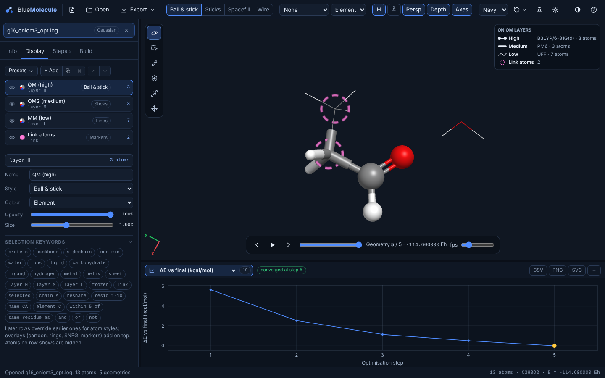

# QM/MM and ONIOM calculations

BlueMolecule reads multi-layer calculations and shows each layer in its own style.



## Supported programs

| Program | Calculations | What is read |
|---|---|---|
| **Gaussian** | ONIOM with 2 or 3 layers: any QM:QM, QM:MM or QM:QM:MM combination, including Amber, UFF and Dreiding for the low layer; optimisations with microiterations; frequencies | The layer of every atom (H, M or L), link atoms with their element, type and the atom they are bonded to, MM atom types and charges, and freeze codes. For each optimisation step: the total (extrapolated) ONIOM energy and the layer energies (high-model, low-model, low-real, and for 3 layers also med-mid, med-model and low-mid) |
| **ORCA** | QM/MM (ORCA 6), QM/XTB and QM/QM2 | The QM (and QM2) atoms, active and frozen atoms, and link atoms. For each step: the total energy and its components (QM, MM, QM–MM, or high-model, low-model and low-real for QM/QM2) |
| **CP2K** | QM/MM | The QM atoms and link atoms; the energy of each optimisation step |
| **xtb** | ONIOM (`--oniom`, e.g. GFN2-xTB:GFN-FF) | The inner-region atoms and the two methods |

## Energies: one point per optimisation step

A QM/MM or ONIOM output prints many energies in each optimisation cycle:
- the SCF energy of every sub-calculation (the model system at the high level, the model system at the low level,
  the real system at the low level);
- MM energies of the microiterations;
- the total.

A reader that treats every printed energy as a new point produces an energy graph that jumps back and forth.

BlueMolecule keeps **one geometry per optimisation step**: the full system, with **the total energy only**. For
Gaussian that is the `ONIOM: extrapolated energy`; for ORCA, the total QM/MM (or QM/QM2) energy. The layer and
component energies are read and stored with each step, but the interface currently plots only the total (see
[limitations](limitations.md)).

When an output does not echo the molecule in Cartesian form, BlueMolecule cannot assign the layers and says so
under **Reader notes**. For example, this happens with Gaussian `geom=check`, where the molecule is taken from the
checkpoint. The geometries and energies are still read.

## Viewing the layers

When a QM/MM or ONIOM file is opened, the **QM/MM layers** preset is applied automatically:

| Layer | Default style |
|---|---|
| High layer, or QM region | Ball & stick |
| Medium layer, or QM2 region | Sticks |
| Low layer, or MM region | Lines |
| Frozen atoms | Dimmed |
| Link atoms | Marked with a dashed ring |

A **legend** in the corner of the 3D view names each layer's method, for example `B3LYP/6-31G(d)`, `PM6` or `UFF`,
with its atom count.

The **Info** tab lists the layers under Contents (*High layer*, *Medium layer*, *Low layer*, or *QM region* and
*MM region*), with their methods and atom counts. Clicking one selects its atoms. The status bar shows the layer
of the atom under the mouse.

Every part of the preset can be changed in the **Display** tab ([representations](representations.md)): style,
colour (including **colour by QM/MM layer**), opacity and size, row by row. The
[selection language](selection-language.md) has layer keywords:

| Keyword | Atoms |
|---|---|
| `layer H`, `qm`, `high` | The high layer or QM region |
| `layer M`, `qm2`, `medium` | The medium layer or QM2 region |
| `layer L`, `mm`, `low` | The low layer or MM region |
| `link` | Link atoms |
| `frozen` / `active` | Frozen and active (optimised) atoms |

Some useful rows:

```text
layer H                                 the QM region, e.g. ball & stick
same residue as within 5 of layer H     whole residues around it, e.g. sticks
layer L and not water                   the MM environment without the solvent, e.g. lines
water and within 8 of layer H           only the nearby water
frozen                                  frozen atoms, e.g. ghost (translucent)
```

For a protein environment, combine the layer rows with the macromolecule styles. For example, show
`protein and layer L` as a cartoon and `layer H` as ball & stick.

## Large QM/MM outputs

QM/MM optimisations of whole proteins produce very large outputs. They are read in chunks, so a 600 MB or 1 GB log
opens normally if the computer has enough memory. See [Large files](large-files-and-trajectories.md).

## Please report problems

The QM/MM and ONIOM readers were written from the programs' documented output layouts and tested on synthetic
outputs. They have **not yet been checked against real QM/MM outputs of every program and version**. ORCA's QM/MM
output in particular differs between versions. If the layers, link atoms or energies of one of your files look
wrong, please open an issue, if possible with a trimmed copy of the output ([CONTRIBUTING.md](../CONTRIBUTING.md)).
