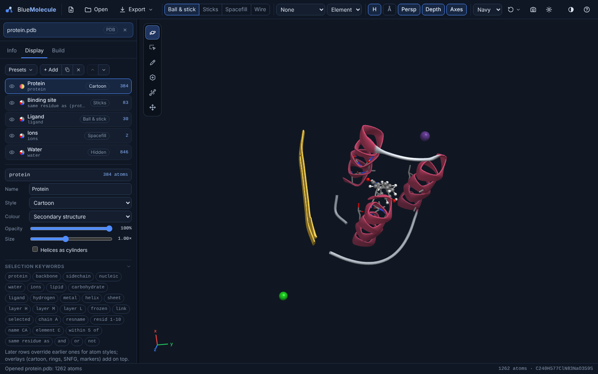
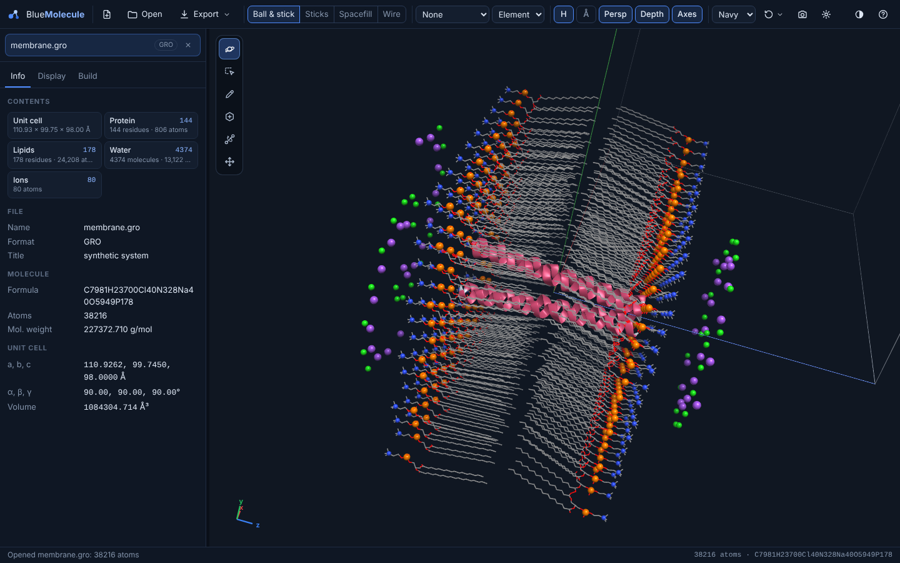
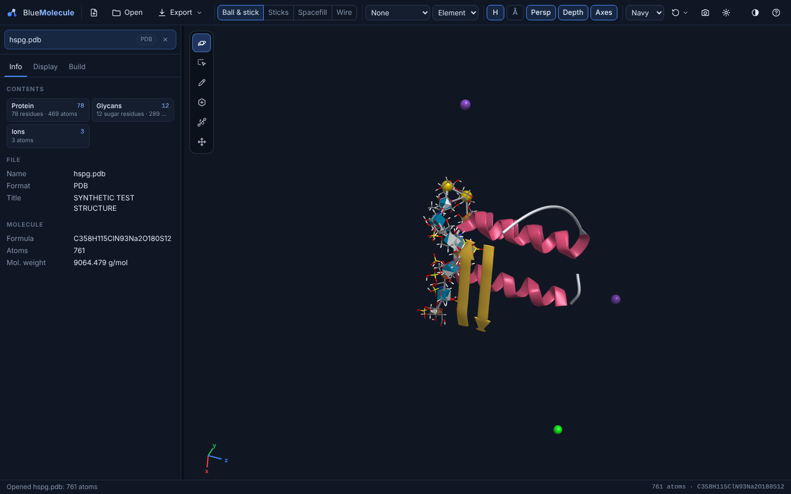

# Representations

The **Display** tab decides which atoms are drawn, how and in what colour. It works the same way for a
three-atom molecule, a QM/MM model and a 300,000-atom membrane system.

## Display rows

The view is a list of **rows**. Each row has:

| Field | Meaning |
|---|---|
| Visibility (eye icon) | Turn the row on or off without deleting it |
| **Name** | A label for the row, e.g. "Binding site" |
| **Selection** | Which atoms the row applies to, in the [selection language](selection-language.md), e.g. `protein`, `layer H` or `within 5 of ligand`. The atom count updates as you type; mistakes are underlined with a message |
| **Style** | How the atoms are drawn (see below) |
| **Colour** | A colour scheme, or one uniform colour |
| **Opacity** | 10–100 % |
| **Size** | 0.25–2 ×: a scale for the spheres and cylinders of the row |

The rules:
- Rows are applied **from top to bottom**, and a **later row overrides an earlier one** for the atoms they share.
  Put the general rows first ("everything as lines") and the specific ones below ("the ligand as ball & stick").
- **Overlay styles** (cartoon, trace, rings, SNFG symbols, markers) are drawn **on top** of the atom styles and do
  not replace them.
- **Atoms that no row shows are hidden.**

The buttons above the list:
- **Presets**: choose a ready-made view.
- **+ Add**: add a row.
- Duplicate or delete the selected row.
- ↑ / ↓: move the selected row.

Below the list, **Selection keywords** shows clickable examples of every keyword.

The toolbar's style buttons (Ball & stick, Sticks, Spacefill, Wire) set the style of the default **All atoms** view
of small molecules.

## Styles

| Style | Kind | Description |
|---|---|---|
| Ball & stick | atoms | Spheres and cylinders |
| Sticks | atoms | Cylinders only, with rounded ends |
| Lines | atoms | Thin lines: the cheapest style, good for large environments |
| Wire (thin tubes) | atoms | Thin cylinders |
| Spacefill | atoms | Van der Waals spheres |
| Ghost (translucent) | atoms | Faint, see-through spheres and bonds: context without clutter |
| Hidden | atoms | Not drawn |
| Lipid | atoms | Tails as lines, phosphorus and nitrogen as spheres, hydrogens hidden |
| Cartoon | overlay | Protein ribbons: helices, arrows for β-strands, a tube for coils. Option: **Helices as cylinders** |
| Trace | overlay | A tube through the Cα atoms of proteins and the P atoms of nucleic acids |
| Filled rings | overlay | Ring polygons, e.g. sugar rings coloured by monosaccharide |
| SNFG symbols | overlay | 3D glycan symbols at the centres of sugar rings ([below](#carbohydrates-and-glycans)) |
| Markers (rings) | overlay | Dashed rings around atoms, used for QM/MM link atoms |

Each bond half takes the style of its own atom. A bond between a ball-and-stick atom and a line atom is therefore
half cylinder, half line.

## Colour schemes

| Scheme | Colours atoms by |
|---|---|
| Element | The usual CPK/Jmol element colours |
| QM/MM layer | High, medium or low layer |
| Chain | Chain or segment |
| Residue name | One colour per residue name |
| Residue type | Nonpolar, polar, acidic, basic; nucleic, lipid, carbohydrate, water, ion, ligand |
| Secondary structure | Helix, sheet, coil |
| Rainbow (N→C) | Position along each chain |
| Monosaccharide (SNFG) | The standard glycan colours (Glc blue, Gal yellow, Man green, …) |
| Charge | Atomic charge: blue (negative), white, red (positive) |
| B-factor | The B-factor column of PDB and mmCIF files |
| Occupancy | The occupancy column |
| Uniform colour | One colour of your choice |

## Presets

When a file is opened, BlueMolecule looks at what it contains and applies a preset. It checks these conditions in
order, and the first one that matches wins:

| Order | Preset | Chosen when the file has… | Rows |
|---|---|---|---|
| 1 | **QM/MM layers** | QM/MM or ONIOM layers | High layer as ball & stick, medium as sticks, low as lines; frozen atoms dimmed; link atoms marked; a legend with the methods ([QM/MM](qmmm-oniom.md)) |
| 2 | **Membrane** | 5 or more lipid residues | Protein cartoon; lipid tails as lines with P and N spheres; water hidden; ions as small spheres |
| 3 | **Glycan / proteoglycan** | Sugars together with protein, or 3 or more sugars | Protein cartoon; sugars as sticks with filled rings and SNFG symbols |
| 4 | **Nucleic acid** | 4 or more nucleotides | Backbone tube with base slabs coloured by base; protein cartoon |
| 5 | **Protein–ligand** | 20 or more amino-acid residues | Cartoon coloured by secondary structure; ligand as ball & stick; residues within 5 Å of it as sticks; water hidden; ions as small spheres |
| 6 | **All atoms** | Anything else | Every atom in the toolbar style |

Any preset can be applied from **Presets** and then edited row by row. Your rows are kept for each open document
separately.

## How residues are recognised

Atoms are grouped into residues by residue name and number, and each residue is put into one class: protein,
nucleic acid, water, ion, lipid, carbohydrate or ligand. The classes come from name tables:

- **Protein:** the 20 amino acids and their protonation variants, in the Amber, CHARMM and GROMACS spellings: HID,
  HIE, HIP, HSD, HSE, HSP, CYX, ASH, GLH, LYN and others. Also common modified residues and N- or C-terminal
  variants.
- **Nucleic acids:** DNA and RNA nucleotides with their 5′ and 3′ variants, and common modified bases.
- **Water:** HOH, WAT, SOL, TIP3, TIP4P, SPC/E, OPC and other water models.
- **Ions:** Na⁺, Cl⁻, K⁺, Mg²⁺, Ca²⁺, Zn²⁺ and others, in the PDB, CHARMM (SOD, CLA, POT, CAL…) and Amber spellings.
- **Lipids:**
  - CHARMM-GUI phospholipids (POPC, POPE, POPS, DPPC, DOPC…), sphingolipids and ceramides, cardiolipins,
    phosphoinositides, detergents;
  - sterols (CHL1, CHOL…);
  - the split head and tail residues of Amber Lipid14/21 (PC, PE, PA, OL…).
- **Carbohydrates:** PDB chemical-component codes (GLC, BGC, NAG, MAN, GAL, FUC, SIA, IDR, SGN…) and CHARMM-GUI
  glycan names (AGLC, BGLCNA, AIDOA…).
- **Ligand:** any other group of atoms.

The **Info** tab counts each class under Contents. Clicking a class selects it, and the status bar names the
residue under the mouse.

## Proteins

**Secondary structure** comes from the file when it has it: PDB `HELIX`/`SHEET` records or mmCIF
`struct_conf`/`struct_sheet_range`. Otherwise it is computed from the backbone with a simplified DSSP (backbone
hydrogen-bond energies). That finds α-helices and β-ladders, but not 3₁₀ or π helices or turns. It is computed
once per structure, not for every frame of a trajectory.

The **cartoon** is a smooth spline through the Cα atoms. Ribbons are oriented by the peptide planes, β-strands end
in arrows, and coils are tubes. Colour it by secondary structure, chain, rainbow or residue type. A cartoon is
rebuilt while a trajectory plays for systems up to 20,000 atoms. For larger systems the cartoon is not updated
during playback.

## Nucleic acids

The **Nucleic acid** preset draws the sugar–phosphate backbone as a tube through the P atoms, and each base as a
slab coloured by base.

## Lipids and membranes

The **Lipid** style draws the acyl tails as lines and the phosphorus and nitrogen of the head groups as spheres,
with hydrogens hidden. The bilayer surfaces therefore stand out even in very large systems.

## Carbohydrates and glycans

Sugars are shown in three layers:
- sticks;
- **filled rings**, coloured by monosaccharide;
- **SNFG symbols**: the 3D shapes and colours of the *Symbol Nomenclature for Glycans* (Varki et al., *Glycobiology*
  2015), placed at the ring centre and oriented with the ring.

| Shape | Monosaccharide type |
|---|---|
| Sphere | Hexose (Glc, Man, Gal…) |
| Cube | N-acetylhexosamine (GlcNAc, GalNAc…) |
| Divided cube | Hexosamine (GlcN, also N-sulfated GlcNS) |
| Divided diamond | Hexuronic acid (GlcA, IdoA…) |
| Cone | Deoxyhexose (Fuc, Rha…) |
| Star | Pentose (Xyl, Ara…) |
| Diamond | Sialic acids (Neu5Ac, Neu5Gc, Kdn) |
| Pentagon / hexagon | Ketoses (Fru) and Kdo |

The colour gives the stereochemical family, following SNFG: Glc blue, Man green, Gal yellow, Ido brown, Xyl orange,
Fuc red and so on.

**Identifying sugars.** A sugar is identified from its residue name when that name is a known PDB or CHARMM-GUI
code. Otherwise, for **six-membered (pyranose) rings**, it is identified from the ring itself:
- the ring atoms;
- the configuration of each stereocentre;
- the substituents: N-acetyl, N-sulfate, O-sulfate, carboxylate.

This works even when the residue names are unhelpful. For example, the heparan-sulfate units of a test structure are
recognised as **GlcNS6S** and **IdoA2S**. Hovering over a sugar names it in the status bar.

Five-membered (furanose) rings with unknown names are drawn with white symbols.
