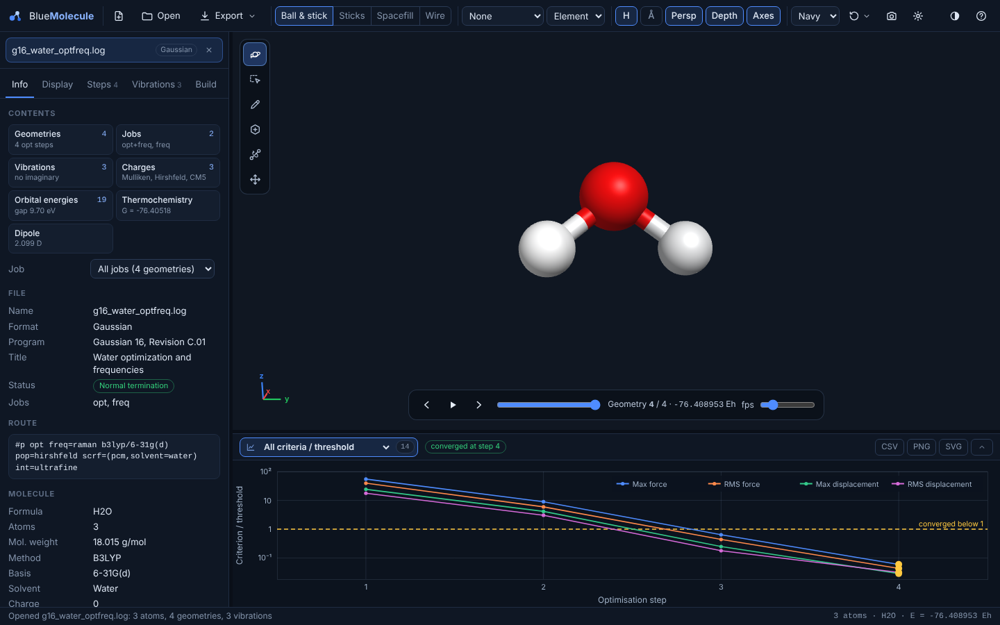

# User guide

This page is a tour of the window and the everyday actions: opening files, moving around, measuring, playing
geometries, using the plot panel and exporting. The specialised topics have their own pages:
- [analysing outputs](analysing-outputs.md);
- [QM/MM and ONIOM](qmmm-oniom.md);
- [representations](representations.md);
- [building and editing](building-and-editing.md).

## The window

| Area | What it holds |
|---|---|
| **Toolbar** (top) | New, Open, Export, display style, labels, colouring, toggles, background, view menu, image, display settings, light/dark theme, help |
| **Document list** (top left) | Every open file, with a badge for its format. Click one to switch; **×** closes it |
| **Tabs** (left) | Only the tabs that apply to the file: **Info**, **Display**, **Steps**, **Vibrations**, **States**, **Surfaces**, **Build** |
| **3D view** (centre) | The molecule. The build tools are at its left edge, the measurement chip at the top and the playbar near the bottom when there are several geometries or an animated mode |
| **Plot panel** (bottom) | Every plot available for the file: optimisation, scan or IRC, spectra, orbital levels, charges |
| **Status bar** (bottom edge) | Messages, what is under the mouse (atom, residue, sugar, layer), and the atom count, formula and energy |

Drag the borders between the sidebar, the 3D view and the plot panel to resize them. **⌃** at the right of the plot
panel collapses it.

## Opening files

- **Open** in the toolbar, or **Ctrl/⌘ + O**. You can select several files at once.
- **Drag and drop** files anywhere in the window.
- From a terminal: `bluemolecule opt.log freq.out orbital.cube`.
- From your file manager: **Open With → BlueMolecule** (see [installation](installation.md)).
- From the **start screen**:
  - **Open files…**;
  - **New molecule** (an empty document for building);
  - a SMILES box that builds a 3D structure;
  - four built-in examples: a Gaussian optimisation + frequency job, an ORCA TD-DFT job, a benzene π-orbital cube
    and cisplatin.

The **format is detected from the content**, not only from the extension. For example, `.out` files from ORCA,
Q-Chem, Psi4, NWChem, GAMESS, MOPAC, CP2K and xtb are told apart by their headers. Files compressed with gzip
(`.gz`) are decompressed while they are read. If BlueMolecule cannot read a file and [Open Babel](installation.md#open-babel-optional)
is installed, the file is converted with Open Babel. The Info tab then says so.

Each file becomes a **document** with its own view, selection, display rows and edits. Anything the reader found
odd is listed under **Reader notes** in the Info tab. Examples are a missing geometry, an unfinished job or skipped
frames.

**Molecular-dynamics files** often split atoms and coordinates across two files:
- Open the **topology or structure first** (Amber prmtop, CHARMM/NAMD PSF, PDB or GRO), then the coordinates or
  trajectory (inpcrd/rst7, DCD, TRR, XTC) with the same number of atoms.
- A topology opened on its own shows a **Coordinates pending** card with an **Open coordinates…** button.
- A trajectory opened without a matching topology is refused, with a message saying what to open first.

See [Large files and trajectories](large-files-and-trajectories.md).

## Moving around

| Action | Mouse or key |
|---|---|
| Rotate | Left-drag |
| Move (pan) | Right-drag, or Shift + drag |
| Rotate in the screen plane | Alt/Option + drag |
| Zoom | Mouse wheel or pinch |
| Centre on an atom | Double-click the atom |
| Reset the view | **R**, or View menu → Reset view |
| Look along X, Y or Z; centre on the selection | View menu (the eye icon) |
| Perspective or orthographic | **P**, or **Persp** in the toolbar |

## Keyboard shortcuts

Press **?** in the window to see this list.

| Key | Action |
|---|---|
| **Ctrl/⌘ + O** | Open files |
| **Ctrl/⌘ + Shift + S** | Save as… (any format) |
| **Space** | Play or pause the geometries or the vibration |
| **← / →** | Previous or next geometry |
| **Home / End** | First or last geometry |
| **1 2 3 4** | Ball & stick, sticks, spacefill, wire |
| **H** | Show or hide hydrogens |
| **L** | Cycle the atom labels |
| **B** | Show or hide bond lengths |
| **P** | Perspective or orthographic |
| **R** | Reset the view |
| **Esc** | Stop the animation or clean-up, clear the selection |
| **N S D T K M** | Build tools: Navigate, Select, Draw, Template, Bond-centric, Manipulate ([building](building-and-editing.md)) |
| **Ctrl/⌘ + A** | Select all atoms |
| **Delete / Backspace** | Delete the selected atoms |
| **Ctrl/⌘ + Z** | Undo. **Ctrl/⌘ + Shift + Z** or **Ctrl + Y**: redo |
| **?** | Help and shortcuts |

## The toolbar

- **New**: an empty document for building a molecule.
- **Open**: open files.
- **Export**: Save as…, Calculation input…, Image…, Vibration animation (see [Saving and exporting](#saving-and-exporting)).
- **Ball & stick / Sticks / Spacefill / Wire**: the basic display style for the whole document. With display rows
  (the Display tab), these set the style of the "All atoms" view; see [representations](representations.md).
- **Labels**: none, element symbol, atom number, symbol + number, or atomic charges.
- **Colour**: by element, or by atomic charge when the file has charges.
- **H**: hydrogens on or off.
- **Å**: bond lengths on or off.
- **Persp**: perspective or orthographic projection.
- **Depth**: depth cueing (fog).
- **Axes**: the axes indicator.
- **Bg**: navy, black, white or grey background.
- **View menu**: reset, look along X, Y or Z, centre on the selection.
- **Camera icon**: save an image of the view.
- **Display settings (gear icon)**:
  - sizes: atom size, bond radius, spacefill scale;
  - the bond tolerance used to find bonds;
  - dummy and ghost atoms;
  - bond orders (double, triple and aromatic bonds drawn as such);
  - hydrogen bonds, the dipole-moment arrow and the unit cell.
- **Sun/moon icon**: light or dark interface.
- **?**: help and shortcuts.

BlueMolecule remembers these settings between sessions, along with the vibration-animation settings, the build-tool
options, the panel sizes and your last choices in the Save as and Calculation input dialogs.

## The tabs

| Tab | Appears when | Contents |
|---|---|---|
| **Info** | Always | A **Contents** overview of everything in the file (click an item to open its tab or plot), the file and program, route or keywords, the molecule (formula, atoms, weight, method, basis, charge, multiplicity, solvent), energies, thermochemistry, orbitals, dipole, charges, unit cell, layer and macromolecule counts, reader notes. See [Analysing outputs](analysing-outputs.md#the-info-tab) |
| **Display** | Always | Display rows: which atoms are shown, how and in what colour. Presets, selections and colour schemes. See [Representations](representations.md) |
| **Steps** | More than one geometry | Every geometry with its energy and ΔE, the convergence criteria of the current one, and a job selector |
| **Vibrations** | Frequencies in the file | Frequencies, symmetries and intensities; animation, arrows, displacing along a mode |
| **States** | Excited states in the file | Energies, wavelengths, oscillator strengths and the orbital transitions of each state |
| **Surfaces** | Volumetric data (cube, XSF grid) | Isosurfaces: isovalue, opacity, colours of the positive and negative lobes |
| **Build** | Always | Building and editing tools. See [Building and editing](building-and-editing.md) |

## Selecting and measuring

- **Click an atom** to select it. Its element, number and coordinates appear in the measurement chip, and the status
  bar describes it: residue, sugar, layer or charge.
- **Click 2, 3 or 4 atoms** to measure a distance, an angle or a dihedral angle. The values update while you
  play through geometries.
- **Click empty space** or press **Esc** to clear the selection.
- The **Select** tool (**S**) adds box selection and fragment selection by double-click
  ([building](building-and-editing.md#the-build-tools)).
- In the [selection language](selection-language.md), `selected` refers to the atoms selected in the view. For
  example, `same residue as selected` shows the whole residues of the clicked atoms.

## Geometries and animation

A file with several geometries (an optimisation, scan, IRC, trajectory or several jobs) shows a **playbar** in
the 3D view. It has previous and next buttons, play/pause, a slider, the current geometry with its energy, and a
speed control (frames per second). The **Steps** tab lists every geometry. Click a row to jump to it.

When a vibrational mode is selected, the playbar animates the mode instead. It shows the frequency and symmetry,
the amplitude and speed, an arrows toggle and a close button.

## The plot panel

The **plot picker** at the left of the plot panel lists every plot available for the file, in groups:

| Group | Plots |
|---|---|
| Optimisation | Energy, ΔE vs final, each convergence criterion against its threshold, RMSD to the final geometry, largest atomic step, all criteria / threshold |
| Scan / IRC, or Geometries | Energy against the scan coordinate or the reaction coordinate, or an energy profile over the geometries |
| Spectra | IR, Raman, UV-Vis, ECD, NMR |
| Orbitals | MO energy-level diagram |
| Charges | Atomic charges per atom |

The number next to the picker is how many plots the file offers. The controls to the right of the picker change
with the plot: broadening, units, ranges and so on (see [Analysing outputs](analysing-outputs.md)).

**Click the plot** to select a geometry, mode, state, orbital level, atom or NMR signal; the 3D view follows.
**CSV**, **PNG** and **SVG** save the current plot: the curve and the sticks as CSV, or the picture.

## Saving and exporting

The **Export** menu offers:

- **Save as…** (**Ctrl/⌘ + Shift + S**): the current geometry, or all geometries for trajectory formats, in any of
  24 formats. These include XYZ and extended XYZ, SDF, Mol2, PDB, CIF, POSCAR, Quantum ESPRESSO and CP2K inputs,
  XSF, GRO, LAMMPS data, Molden (with vibrations), cube (with the volume), CML, CJSON, SMILES and Turbomole
  coord. When Open Babel is installed, its formats appear as an extra group. See [File formats](file-formats.md#saving).
- **Calculation input…**: an input file for Gaussian, ORCA, Psi4, Q-Chem, NWChem, GAMESS, MOPAC, xtb, Molpro or
  Turbomole, with task, method, basis, charge, multiplicity, implicit solvent, cores and memory. See
  [Building and editing](building-and-editing.md#calculation-inputs).
- **Image…**: a PNG of the current view, labels included. Choose 1× (screen) to 4× (print) resolution and,
  optionally, a transparent background. For publications, choose a white background in the toolbar first.
- **Vibration animation**: the selected mode as a multi-frame XYZ file, which other viewers can play.

In the Linux and macOS apps, saving opens the system's Save dialog. The single HTML file saves through the
browser's downloads. Geometries changed in the Build tab are saved as edited. The original file is never modified.
